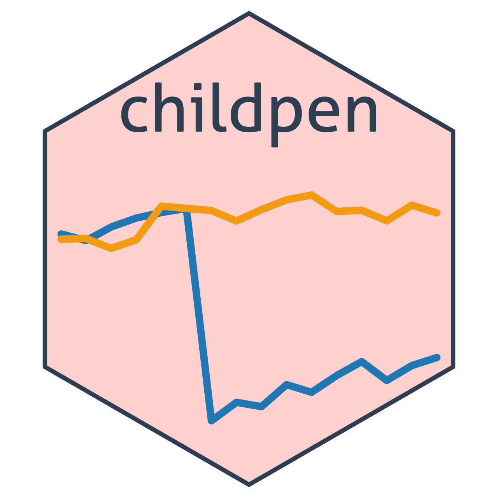

<!-- README.md is generated from README.Rmd. Please edit that file -->

```{r setup, include = FALSE}
knitr::opts_chunk$set(
  collapse = TRUE,
  comment = "#>",
  fig.path = "man/figures/README-",
  out.width = "100%"
)
```

# childpen <a href="https://dorleventer.github.io/childpen/" title="childpen website"></a>

<!-- badges: start -->
[](https://CRAN.R-project.org/package=childpen)
[](https://cran.r-project.org/package=childpen)
[](https://github.com/dorleventer/childpen/actions/workflows/pkgdown.yaml)
[](https://github.com/dorleventer/childpen/actions/workflows/R-CMD-check.yaml)
[](LICENSE)
<!-- badges: end -->

> This package accompanies the paper **Leventer, Dor.** *Identification of Child Penalties.*
> [arXiv:2602.07486](https://arxiv.org/abs/2602.07486).

`childpen` estimates the paper's 2x2 comparisons of parents by age at first birth (a
treatment group against the closest not-yet-treated group, by gender), with standard errors
clustered by person:

- within-gender DID and the triple difference;
- the conventional normalized estimator of child penalties, with the paper's bias-bounding
  exercise (`bias_bounds()`);
- the effect of parenthood on the gender earnings ratio (identified under NTD) and the
  accounting of the gender gap into parenthood and other factors;
- the proportional triple-difference versions of the online appendix;
- aggregates across treatment groups (`aggregate_estimands()`), and pair-by-pair
  validation tests.

`simulate_data()` generates a panel with the paper's patterns and known true values.

## Installation

Install the released version from CRAN:

```{r install_cran, eval = FALSE}
install.packages("childpen")
```

Or the development version from GitHub:

```{r install_package, eval = FALSE}
# install.packages("remotes")
remotes::install_github("dorleventer/childpen")
```

## Example

The effect of parenthood on the gender earnings ratio, by treatment group and event time
(the NTD estimates of the paper's Figure 6b), on simulated data:

```{r example, message = FALSE, fig.height = 3.5}
library(childpen)
library(ggplot2)
sim <- simulate_data(n_individuals = 20000, treatment_groups = 24:32)
res <- multiple_treatment_group_analysis(sim, treatment_groups = 25:28, periods_post = 3,
                                         periods_pre = NULL, verbose = FALSE)
est <- subset(res, method == "NTD" & estimand == "rho_effect")
ggplot(est, aes(event_time, est, ymin = ci_l, ymax = ci_h)) +
  geom_hline(yintercept = 0, linetype = "dashed", colour = "grey50") +
  geom_ribbon(alpha = 0.2) + geom_line() + geom_point() +
  facet_wrap(~ d, nrow = 1, labeller = label_both) +
  labs(x = "Event time", y = "Effect on gender earnings ratio (95% CI)")
```

## Articles

1. [Notation and output](https://dorleventer.github.io/childpen/articles/notation.html): the
   2x2, the estimands, and what each output row is.
2. [Estimation](https://dorleventer.github.io/childpen/articles/estimators.html): the grid of
   comparisons, every estimator and its influence function.
3. [Aggregation](https://dorleventer.github.io/childpen/articles/aggregation.html): estimands
   across treatment groups, weights and standard errors.
4. [Replicating the paper](https://dorleventer.github.io/childpen/articles/replication.html):
   the paper's figures, one by one, on simulated data.
