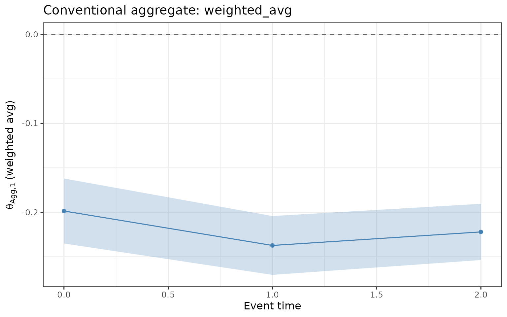
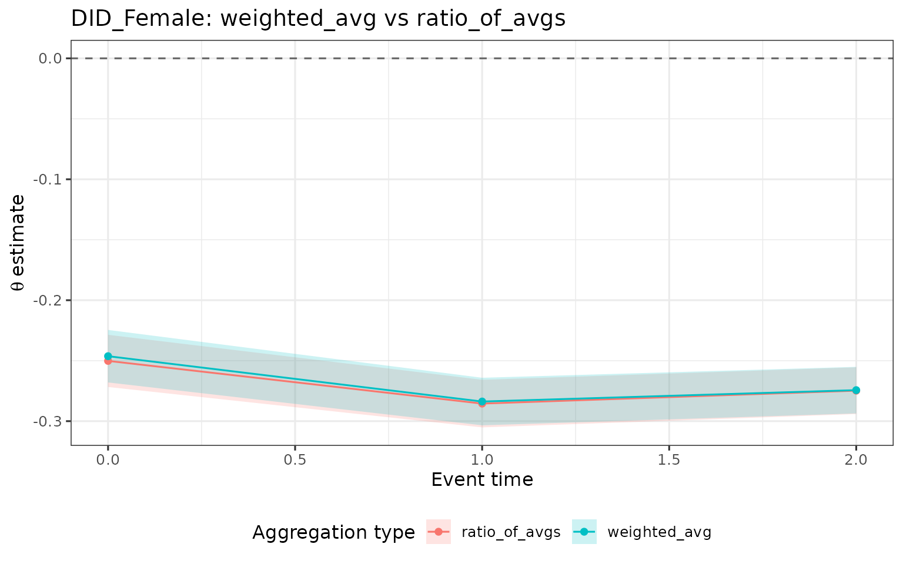
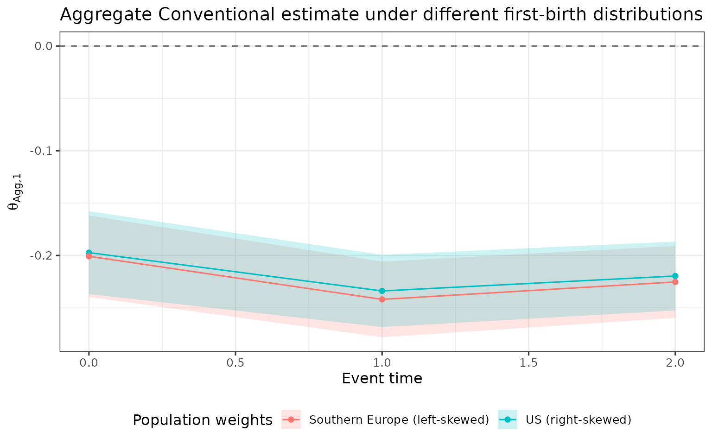
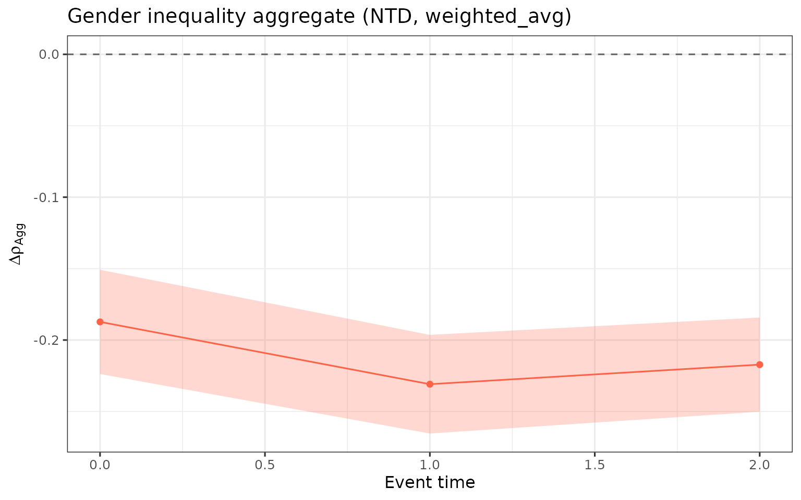

# aggregate-estimands

> **Notation.** For symbol definitions, see the [notation
> vignette](https://dorleventer.github.io/childpen/articles/notation.md).

## Overview

[`multiple_treatment_group_analysis()`](https://dorleventer.github.io/childpen/reference/multiple_treatment_group_analysis.md)
estimates child-penalty effects separately for each treatment group
$`d`$ (age at first birth). Because groups differ in their baseline
earnings, age composition, and selection, a single group’s estimate is
not directly comparable to another’s.
[`aggregate_estimands()`](https://dorleventer.github.io/childpen/reference/aggregate_estimands.md)
collapses the group-specific estimates into a single number per event
time, answering the question: *what is the average effect across the
distribution of first-birth ages?*

Three aggregate estimands are available:

- **weighted_avg** ($`\theta_{\text{Agg},1}`$): weighted average of each
  group’s normalized effect $`\theta(g,d,d+e)`$. Formally,
  $`\theta_{\text{Agg},1}(g,e) = \sum_d w_d \cdot \theta(g,d,d+e)`$,
  where $`w_d`$ are population weights normalised to sum to one.
  Preferred because normalization happens within each group before
  aggregation, so baseline differences do not inflate the average.
- **ratio_of_avgs** ($`\theta_{\text{Agg},2}`$): ratio of the
  weighted-average ATE to the weighted-average APO. Formally,
  $`\theta_{\text{Agg},2}(g,e) = \sum_d w_d \cdot \text{ATE}(g,d,d+e) \;/\; \sum_d w_d \cdot \text{APO}(g,d,d+e)`$.
  This implicitly up-weights high-earning groups (their larger APO
  contributes proportionally more to the pooled denominator), so it
  differs from $`\theta_{\text{Agg},1}`$ when earnings vary across
  groups.
- **weighted_avg of `rho_effect`** ($`\Delta\rho_{\text{Agg}}`$):
  weighted average of `NTD` $`\Delta\rho`$ (`rho_effect`) estimates —
  the aggregate gender-inequality penalty. Formally,
  $`\Delta\rho_{\text{Agg}}(e) = \sum_d w_d \cdot \Delta\rho(d,d+e)`$.

## Simulate and estimate

We simulate 2 000 individuals spanning treatment groups 24–30 (the extra
groups serve as clean controls for the youngest treated cohorts), then
analyse groups 24–27 with two post-treatment periods.

``` r

library(childpen)

data <- simulate_data(n_individuals = 2000, treatment_groups = 24:30)

res <- multiple_treatment_group_analysis(
  data             = data,
  treatment_groups = 24:27,
  periods_post     = 2,
  periods_pre      = NULL,
  verbose          = FALSE
)
```

## Basic aggregation

Calling
[`aggregate_estimands()`](https://dorleventer.github.io/childpen/reference/aggregate_estimands.md)
with default arguments applies sample-proportion weights
(`weights = "sample"`), where each treatment group is weighted by its
share of the sample, as in Leventer (2025). Standard errors account for
the estimation of these weights via the influence-function formula in
the paper’s Appendix G. Pass `weights = "uniform"` (or `NULL`) for
uniform weights.

``` r

agg <- aggregate_estimands(res)
head(agg)
#>   event_time control_offset  estimand       method      agg_type      est
#> 1          0              1 gap_theta Conventional  weighted_avg -0.19863
#> 2          1              2 gap_theta Conventional  weighted_avg -0.23738
#> 3          2              3 gap_theta Conventional  weighted_avg -0.22217
#> 4          0              1     theta   DID_Female ratio_of_avgs -0.25017
#> 5          1              2     theta   DID_Female ratio_of_avgs -0.28547
#> 6          2              3     theta   DID_Female ratio_of_avgs -0.27479
#>          se n_groups     ci_l     ci_h       t
#> 1 0.0186538        4 -0.23519 -0.16207 -10.648
#> 2 0.0168885        4 -0.27048 -0.20428 -14.056
#> 3 0.0161334        4 -0.25379 -0.19054 -13.770
#> 4 0.0110106        4 -0.27175 -0.22859 -22.721
#> 5 0.0100437        4 -0.30516 -0.26579 -28.423
#> 6 0.0098543        4 -0.29411 -0.25548 -27.885
#>                                                                                                                                                                                         p
#> 1 0.0000000000000000000000000177959721049207484593315940123361966179227990038251675760203644910439121223921787873223365750163793563842773437500000000000000000000000000000000000000000000
#> 2 0.0000000000000000000000000000000000000000000070967826282938661396436275209375462340740355324704575319491229538001174842225675027225963950577750443161226010326848856468728854451910593
#> 3 0.0000000000000000000000000000000000000000003836100886242283211800881410713648203343334883769248089459772619145727314567998045477993390537286473019847662241366137436671124305576086044
#> 4 0.0000000000000000000000000000000000000000000000000000000000000000000000000000000000000000000000000000000000000000027925448022253425661212982653191493412559479795135324075007813192015
#> 5 0.0000000000000000000000000000000000000000000000000000000000000000000000000000000000000000000000000000000000000000000000000000000000000000000000000000000000000000000000000000000010464
#> 6 0.0000000000000000000000000000000000000000000000000000000000000000000000000000000000000000000000000000000000000000000000000000000000000000000000000000000000000000000000000040250669249
```

The output has one row per `event_time × estimand × method × agg_type`
combination. The `n_groups` column records how many treatment groups
contributed — useful for spotting cells where edge-of-sample groups drop
out due to `max_control_group`/`min_pre_age` bounds.

## Plot aggregate results

Plot the `weighted_avg` aggregate for the `Conventional` method across
event times, with 95% confidence ribbons.

``` r

agg |>
  filter(agg_type == "weighted_avg", method == "Conventional", estimand == "gap_theta") |>
  ggplot(aes(x = event_time, y = est, ymin = ci_l, ymax = ci_h)) +
  geom_ribbon(fill = "steelblue", alpha = 0.25, color = NA) +
  geom_line(color = "steelblue") +
  geom_point(color = "steelblue") +
  geom_hline(yintercept = 0, linetype = "dashed", color = "grey40") +
  labs(
    x     = "Event time",
    y     = expression(theta[Agg * "," * 1] ~ "(weighted avg)"),
    title = "Conventional aggregate: weighted_avg"
  )
```



## Compare aggregation types

`weighted_avg` and `ratio_of_avgs` answer the same underlying question
but weight groups differently. When high first-birth-age groups have
higher counterfactual earnings than low first-birth-age groups,
`ratio_of_avgs` assigns them more weight (the APO enters the denominator
for each group before the ratio is formed across groups). The two
estimands therefore diverge whenever earnings are heterogeneous across
groups.

``` r

agg |>
  filter(
    agg_type %in% c("weighted_avg", "ratio_of_avgs"),
    method   == "DID_Female",
    estimand == "theta"
  ) |>
  ggplot(aes(
    x     = event_time,
    y     = est,
    ymin  = ci_l,
    ymax  = ci_h,
    color = agg_type,
    fill  = agg_type
  )) +
  geom_ribbon(alpha = 0.2, color = NA) +
  geom_line() +
  geom_point() +
  geom_hline(yintercept = 0, linetype = "dashed", color = "grey40") +
  labs(
    x     = "Event time",
    y     = expression(theta ~ "estimate"),
    title = "DID_Female: weighted_avg vs ratio_of_avgs",
    color = "Aggregation type",
    fill  = "Aggregation type"
  ) +
  theme(legend.position = "bottom")
```



If the two lines are similar, earnings are approximately homogeneous
across groups. Divergence is a sign that the treatment-group
distribution interacts with baseline earnings levels, and the researcher
must decide which weighting regime is more policy-relevant.

## Custom weights

By default treatment groups are weighted by their sample proportions.
Researchers may instead want to weight groups by their empirical share
in a target population. Below we contrast two stylized distributions:

- **Right-skewed** (mimicking the US): most first births concentrate at
  younger ages.
- **Left-skewed** (mimicking Southern Europe): most first births
  concentrate at older ages.

``` r

groups <- as.character(24:27)

# Right-skewed: more weight on younger groups
w_us <- setNames(c(0.40, 0.30, 0.20, 0.10), groups)

# Left-skewed: more weight on older groups
w_se <- setNames(c(0.10, 0.20, 0.30, 0.40), groups)

agg_us <- aggregate_estimands(res, weights = w_us)
agg_se <- aggregate_estimands(res, weights = w_se)

bind_rows(
  mutate(agg_us, population = "US (right-skewed)"),
  mutate(agg_se, population = "Southern Europe (left-skewed)")
) |>
  filter(
    agg_type == "weighted_avg",
    method   == "Conventional",
    estimand == "gap_theta"
  ) |>
  ggplot(aes(
    x     = event_time,
    y     = est,
    ymin  = ci_l,
    ymax  = ci_h,
    color = population,
    fill  = population
  )) +
  geom_ribbon(alpha = 0.2, color = NA) +
  geom_line() +
  geom_point() +
  geom_hline(yintercept = 0, linetype = "dashed", color = "grey40") +
  labs(
    x     = "Event time",
    y     = expression(theta[Agg * "," * 1]),
    title = "Aggregate Conventional estimate under different first-birth distributions",
    color = "Population weights",
    fill  = "Population weights"
  ) +
  theme(legend.position = "bottom")
```



When younger groups bear larger penalties than older groups (or vice
versa), the choice of weight vector shifts the aggregate estimate.
Reporting both provides a sensitivity check on how much the aggregate
depends on the first-birth distribution.

## Gender inequality aggregate

The `weighted_avg` aggregate of `NTD` `rho_effect`
($`\Delta\rho_{\text{Agg}}`$) is the weighted average of `NTD`
$`\Delta\rho`$ estimates across treatment groups. It measures how
parenthood affects the female-to-male earnings ratio: negative values
indicate that mothers bear a larger proportional penalty — the
female-to-male earnings ratio is lower post-birth than the
counterfactual ratio.

``` r

agg |>
  filter(agg_type == "weighted_avg", estimand == "rho_effect", method == "NTD") |>
  ggplot(aes(x = event_time, y = est, ymin = ci_l, ymax = ci_h)) +
  geom_ribbon(fill = "tomato", alpha = 0.25, color = NA) +
  geom_line(color = "tomato") +
  geom_point(color = "tomato") +
  geom_hline(yintercept = 0, linetype = "dashed", color = "grey40") +
  labs(
    x     = "Event time",
    y     = expression(Delta * rho[Agg]),
    title = "Gender inequality aggregate (NTD, weighted_avg)"
  )
```



A flat, negative profile indicates a persistent parenthood-driven gender
gap; values closer to zero at later event times suggest the gap narrows
as parents age away from the birth event.
