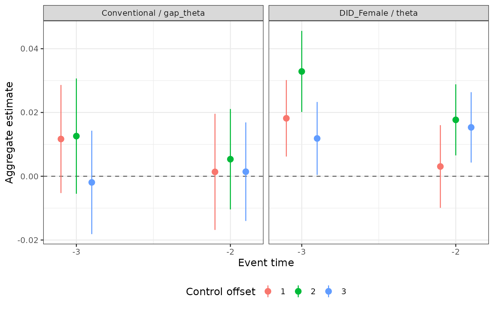
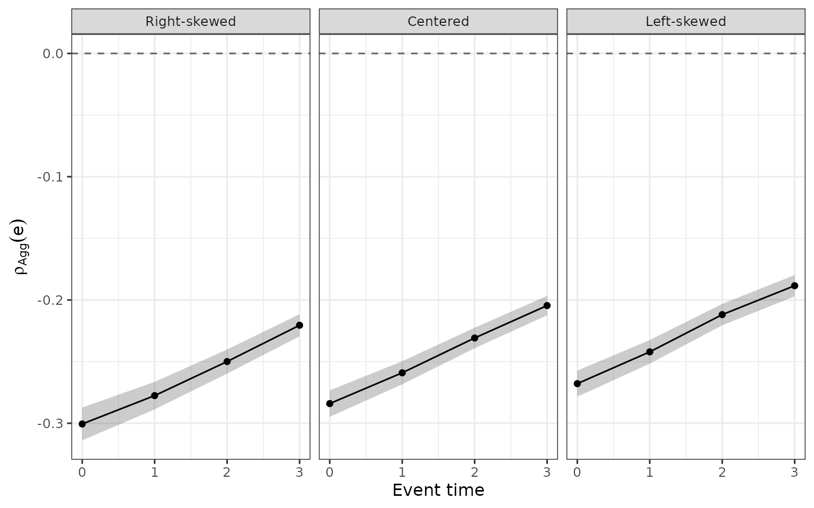

# Aggregation

[`aggregate_estimands()`](https://dorleventer.github.io/childpen/reference/aggregate_estimands.md)
averages the treatment-group-specific estimates of
[`multiple_treatment_group_analysis()`](https://dorleventer.github.io/childpen/reference/multiple_treatment_group_analysis.md)
across treatment groups, by event time (Section 5 of Leventer 2025,
[*Identification of Child
Penalties*](https://arxiv.org/abs/2602.07486)). Symbols and row labels
are in [Notation and
output](https://dorleventer.github.io/childpen/articles/notation.md),
the estimators and influence functions in
[Estimation](https://dorleventer.github.io/childpen/articles/estimators.md).
Equation, section and theorem numbers refer to the main text; appendices
are referred to by name.

The examples use one simulated panel. Treatment groups 24-30 at event
times 0-3 use control groups up to 34, so every treatment group has a
cell at every event time.

``` r

library(childpen)
sim <- simulate_data(20000, 24:34)
res <- multiple_treatment_group_analysis(sim, 24:30, periods_post = 3,
                                         periods_pre = NULL, verbose = FALSE)
```

The result carries the person-level influence functions that
[`aggregate_estimands()`](https://dorleventer.github.io/childpen/reference/aggregate_estimands.md)
reads, so it is passed on unmodified.

## 1. Aggregate causal estimands

For event time $`e`$, let $`\mathcal{D}(e) = \{d : d + e < D_{\max}\}`$
be the treatment groups that have an estimate. Since the control group
is $`d' = d + e + 1`$, the condition is $`d' \le D_{\max}`$, the bound
set by `max_control_group`. With $`\mathbb{E}_D`$ the expectation over
the treatment distribution, Section 5.1 defines

``` math
\rho_{\mathrm{Agg}}(e) = \mathbb{E}_D\big[\rho(D, D, D + e) - \rho(D, \infty, D + e) \mid D + e < D_{\max}\big] \qquad \text{(eq. (10))},
```
``` math
\theta_{\mathrm{Agg},1}(g, e) = \mathbb{E}_D\big[\theta(g, D, D + e) \mid G = g,\, D + e < D_{\max}\big],
```
``` math
\theta_{\mathrm{Agg},2}(g, e) = \frac{\mathbb{E}_D\big[\mathrm{ATE}(g, D, D + e) \mid G = g,\, D + e < D_{\max}\big]}{\mathbb{E}_D\big[\mathrm{APO}(g, D, \infty, D + e) \mid G = g,\, D + e < D_{\max}\big]},
```
``` math
\Delta\theta_{\mathrm{Agg}}(e) = \mathbb{E}_D\big[\theta(f, D, D + e) - \theta(m, D, D + e) \mid D + e < D_{\max}\big] \qquad \text{(eq. (11))}.
```

The package replaces each treatment-group causal estimand by its 2x2
descriptive counterpart $`B_d`$ and the treatment distribution by
weights $`w_d`$ (next section), so that
$`\hat A(e) = \sum_{d \in \mathcal{D}(e)} w_d \hat B_d`$. The rows of
[`aggregate_estimands()`](https://dorleventer.github.io/childpen/reference/aggregate_estimands.md)
are identified by `method`, `estimand` and `agg_type`:

| `method` | `estimand` | `agg_type` | aggregate | $`B_d`$ |
|----|----|----|----|----|
| `DID_Female`, `DID_Male` | `theta` | `weighted_avg` | $`\theta_{\mathrm{Agg},1}(g, e)`$ | $`\delta_\theta(g)`$ |
| `DID_Female`, `DID_Male` | `theta` | `ratio_of_avgs` | $`\theta_{\mathrm{Agg},2}(g, e)`$ | $`\delta_{\mathrm{ATE}}(g)`$ and $`\delta_{\mathrm{APO}}(g)`$, averaged separately and divided |
| `NTD` | `rho_effect` | `weighted_avg` | $`\rho_{\mathrm{Agg}}(e)`$ | $`\delta_{\Delta\rho}`$ |
| `Conventional` | `gap_theta` | `weighted_avg` | $`\Delta\theta_{\mathrm{Agg}}(e)`$ | $`\delta_{\Delta\theta}`$ |
| `TD_E_LOGS` | `rho_effect` | `weighted_avg` | $`\rho_{\mathrm{Agg}}(e)`$ under TD-E-LOGS | $`\delta_{\Delta\rho}`$ with $`\delta^{\times}_{\mathrm{APO}}`$ |
| `TD`, `TD_PR`, accounting rows of `NTD` and `TD_E_LOGS` | `gap_ATE`, `gap_theta_pre`, `rho_obs`, `rho_cf`, `share_parenthood`, `share_other` | `weighted_avg` | weighted average of the group-level row; no symbol in the paper | the group-level row |

The output has one row per event time, `control_offset`, `estimand`,
`method` and `agg_type`, with `est`, `se`, `n_groups` (treatment groups
with positive weight), `ci_l`, `ci_h`, `t` and `p`.

``` r

agg <- aggregate_estimands(res)
agg |>
  filter(event_time == 2, estimand %in% c("theta", "gap_theta", "rho_effect"),
         method %in% c("DID_Female", "Conventional", "NTD")) |>
  select(method, estimand, agg_type, est, se, n_groups)
#>         method   estimand      agg_type     est       se n_groups
#> 1 Conventional  gap_theta  weighted_avg -0.2273 0.004128        7
#> 2   DID_Female      theta ratio_of_avgs -0.2990 0.002595        7
#> 3   DID_Female      theta  weighted_avg -0.3033 0.002533        7
#> 4          NTD rho_effect  weighted_avg -0.2222 0.004226        7
```

**$`\theta_{\mathrm{Agg},1}`$ and $`\theta_{\mathrm{Agg},2}`$.** Writing
$`\mathrm{ATE}(g) = \theta(g)\,\mathrm{APO}(g, \infty)`$, Section 5.1
shows that $`\theta_{\mathrm{Agg},2}`$ is also a weighted average of the
$`\theta(g, d, d + e)`$, with weights
``` math
w(g, d, e) = \frac{p(g, d, e)\,\mathrm{APO}(g, d, \infty, d + e)}{\sum_{k:\, k + e < D_{\max}} p(g, k, e)\,\mathrm{APO}(g, k, \infty, k + e)}, \qquad p(g, d, e) = \Pr(D = d \mid G = g,\, D + e < D_{\max}).
```
Where $`\theta_{\mathrm{Agg},1}`$ weights by the treatment distribution,
$`\theta_{\mathrm{Agg},2}`$ weights by the treatment distribution times
the counterfactual APO, so treatment groups with higher counterfactual
earnings receive more weight; the paper notes these are typically the
later-treated groups. The paper takes $`\theta_{\mathrm{Agg},1}`$ as the
preferable aggregate estimand for this reason (Section 5.1).

``` r

agg |>
  filter(method == "DID_Female", estimand == "theta") |>
  select(event_time, agg_type, est) |>
  pivot_wider(names_from = agg_type, values_from = est)
#> # A tibble: 4 × 3
#>   event_time ratio_of_avgs weighted_avg
#>        <int>         <dbl>        <dbl>
#> 1          0        -0.317       -0.320
#> 2          1        -0.305       -0.309
#> 3          2        -0.299       -0.303
#> 4          3        -0.297       -0.302
```

**Aggregating before or after differencing.** For the gender gap,
Section 5.1 aggregates the within-group difference,
$`\Delta\theta_{\mathrm{Agg}}(e)`$, rather than differencing the two
within-gender aggregates,
$`\theta_{\mathrm{Agg},1}(f, e) - \theta_{\mathrm{Agg},1}(m, e)`$. The
two coincide only when the male and female treatment distributions are
identical, and the second confounds differences in group-specific
effects with gender differences in the treatment distribution.
Accordingly `Conventional` (like `NTD`) uses weights pooled over
genders, while `DID_Female` and `DID_Male` use weights within gender.

## 2. Weights

| `weights` | weight of treatment group $`d`$ in $`\mathcal{D}(e)`$ |
|----|----|
| `"sample"` (default) | the share of persons in the group: $`w_d = n_d / \sum_{k \in \mathcal{D}(e)} n_k`$, where $`n_d`$ counts persons of both genders with $`D = d`$. For `DID_Female` and `DID_Male`, shares within gender: $`w_{g,d} = n_{g,d} / \sum_{k \in \mathcal{D}(e)} n_{g,k}`$ |
| `"uniform"` or `NULL` | $`1/m_e`$, with $`m_e`$ the number of groups in $`\mathcal{D}(e)`$ |
| a named numeric vector | proportional to the entry named $`d`$, renormalized to sum to one over $`\mathcal{D}(e)`$. Groups missing from the vector get weight zero, with a warning |

``` r

w_named <- setNames(dnorm(24:30, mean = 27, sd = 3), 24:30)
bind_rows(
  sample  = aggregate_estimands(res, weights = "sample",  methods = "NTD"),
  uniform = aggregate_estimands(res, weights = "uniform", methods = "NTD"),
  named   = aggregate_estimands(res, weights = w_named,   methods = "NTD"),
  .id = "weights"
) |>
  filter(estimand == "rho_effect", event_time %in% c(0, 3)) |>
  select(weights, event_time, est, se, n_groups)
#>   weights event_time     est       se n_groups
#> 1  sample          0 -0.2767 0.005244        7
#> 2  sample          3 -0.1970 0.004096        7
#> 3 uniform          0 -0.2843 0.005427        7
#> 4 uniform          3 -0.2044 0.004060        7
#> 5   named          0 -0.2840 0.005471        7
#> 6   named          3 -0.2045 0.004017        7
```

**Groups that drop out.** A treatment group has a cell at event time
$`e`$ only if its control group $`d + e + 1`$ is at most
`max_control_group` ($`D_{\max}`$ in the paper). Groups beyond the bound
drop out at later event times, and `n_groups` records how many remain.

``` r

res_cap <- multiple_treatment_group_analysis(sim, 24:30, periods_post = 3, periods_pre = NULL,
                                             max_control_group = 32, verbose = FALSE)
bind_rows(
  `Inf` = aggregate_estimands(res,     methods = "NTD"),
  `32`  = aggregate_estimands(res_cap, methods = "NTD"),
  .id = "max_control_group"
) |>
  filter(estimand == "rho_effect") |>
  select(max_control_group, event_time, est, n_groups)
#>   max_control_group event_time     est n_groups
#> 1               Inf          0 -0.2767        7
#> 2               Inf          1 -0.2516        7
#> 3               Inf          2 -0.2222        7
#> 4               Inf          3 -0.1970        7
#> 5                32          0 -0.2767        7
#> 6                32          1 -0.2516        7
#> 7                32          2 -0.2360        6
#> 8                32          3 -0.2148        5
```

With `max_control_group = 32`, group 30 has cells at $`e = 0, 1`$ only
and group 29 at $`e \le 2`$, so $`\mathcal{D}(e)`$ shrinks and the
weights change with $`e`$. As the footnote to eq. (10) notes (following
Callaway and Sant’Anna 2021), a comparison of aggregates across $`e`$
then combines variation in causal effects with a shift in the
composition of treatment groups. The composition is the same at every
event time when each group in the aggregate has a cell at each of them,
as with `max_control_group = Inf` above (`n_groups` is 7 throughout).

## 3. Standard errors

Let $`B_d`$ be the estimate of treatment group $`d`$,
$`p_d = \Pr(D = d)`$ its population share,
$`P_e = \sum_{d \in \mathcal{D}(e)} p_d`$ and $`w_d = p_d / P_e`$. The
influence function of $`A(e) = \sum_{d \in \mathcal{D}(e)} w_d B_d`$ is
(the aggregate estimator section of the appendix on estimation and
inference)
``` math
\psi_{A(e)} = \frac{1}{P_e} \sum_{d \in \mathcal{D}(e)} \Big[ \big(B_d - A(e)\big)\,\psi_{p_d} + p_d\,\psi_{B_d} \Big], \qquad \psi_{p_d} = 1\{D = d\} - p_d .
```
For the within-gender rows the share is the joint share of gender $`g`$
and group $`d`$, with $`1\{G = g, D = d\} - p_{g,d}`$ in place of
$`\psi_{p_d}`$. With `"uniform"` or fixed weights the first term is
absent; with `"sample"` it accounts for the estimated shares. For
`ratio_of_avgs` the chain rule is applied to the ratio of the two
weighted averages, each with its share term, and the influence function
of `share_other` is minus that of `share_parenthood`.

The group-level influence functions are summed per person across
treatment groups before they are squared, with clusters at the person
level,
``` math
\widehat{\mathrm{Var}}(\hat A) = \frac{1}{n^2} \sum_{c} \Big( \sum_{i \in c} \hat\psi_i \Big)^2 \frac{G}{G - 1},
```
for $`n`$ person-age rows and $`G`$ persons. A person who serves as a
control group member for several treatment groups therefore enters
several terms of the same sum. The share term is put on the person-age
scale with the average number of ages per person, which is exact for a
balanced panel. The estimators and the influence functions of the
group-level rows are in
[Estimation](https://dorleventer.github.io/childpen/articles/estimators.md).

The table compares the `se` of
[`aggregate_estimands()`](https://dorleventer.github.io/childpen/reference/aggregate_estimands.md)
under uniform weights with $`\sqrt{\sum_d w_d^2\,\mathrm{se}_d^2}`$, the
standard error if the group-level estimates were independent. The latter
is also the calculation used, with a warning, when `results` has lost
its influence-function attributes (for example a table read back from a
file).

``` r

agg_u <- aggregate_estimands(res, weights = "uniform", methods = "NTD") |>
  filter(estimand == "rho_effect") |>
  select(event_time, est, se)
indep <- res |>
  filter(method == "NTD", estimand == "rho_effect") |>
  group_by(event_time) |>
  summarise(se_independent = sqrt(sum(se^2)) / n())
left_join(agg_u, indep, by = "event_time")
#>   event_time     est       se se_independent
#> 1          0 -0.2843 0.005427       0.004457
#> 2          1 -0.2599 0.004748       0.004062
#> 3          2 -0.2309 0.004263       0.003828
#> 4          3 -0.2044 0.004060       0.003808
```

## 4. Pre-treatment event times

With `include_pre = TRUE`, pre-treatment event times are aggregated as
well. A pre-treatment event time has one cell per control group,
$`d' = d + 1, \dots, d + H + 1`$, and each `control_offset` $`d' - d`$
is aggregated separately, so each row is the aggregate of the validation
estimates of one treatment-control distance. (After treatment
`control_offset` equals `event_time` + 1, and each event time has one
aggregate.) With the default `pre = 1` and `periods_pre = K`, the
pre-treatment event times are $`-(1 + K), \dots, -2`$; the baseline is
$`e = -1`$.

``` r

res_pre <- multiple_treatment_group_analysis(sim, 26:28, periods_post = 2, periods_pre = 2,
                                             verbose = FALSE)
agg_pre <- aggregate_estimands(res_pre, include_pre = TRUE,
                               methods = c("DID_Female", "Conventional"))
agg_pre |>
  filter(event_time < 0, agg_type == "weighted_avg") |>
  mutate(row = paste(method, estimand, sep = " / "),
         control_offset = factor(control_offset)) |>
  ggplot(aes(x = event_time, y = est, ymin = ci_l, ymax = ci_h, color = control_offset)) +
  geom_hline(yintercept = 0, linetype = "dashed", color = "grey40") +
  geom_pointrange(position = position_dodge(width = 0.3)) +
  facet_wrap(~ row) +
  scale_x_continuous(breaks = -3:-2) +
  labs(x = "Event time", y = "Aggregate estimate", color = "Control offset") +
  theme(legend.position = "bottom")
```



Under no anticipation, a zero pre-treatment `DID_Female` or `DID_Male`
`theta` corresponds to $`\gamma_{\mathrm{PT}}(g) = 0`$ and a zero
`Conventional` `gap_theta` to the NTD-PT restriction at that age
(Proposition 1; see [Notation and
output](https://dorleventer.github.io/childpen/articles/notation.md)).

## 5. Comparing aggregates across strata

Studies compute aggregates within a stratum, such as a country or a
parent type, and compare them across strata (Section 5.2). An aggregate
depends on the treatment distribution: strata with different
distributions of age at first birth give different aggregates even when
the treatment-group-specific effects are the same, for example when
parents have children earlier in one country than in another and early
treatment groups receive more weight.

Figure 9 of the paper illustrates this. It keeps the
treatment-group-specific estimates of the effect of parenthood on the
gender earnings ratio fixed, and aggregates them with three treatment
distributions, normal densities with standard deviation 3 and means 26,
29 and 32 over the treatment groups $`D \in [24, 34]`$ (right-skewed,
centered, left-skewed). The same exercise with the simulated group
estimates `res`, with means 24, 27 and 30 over the treatment groups
24-30 (three years either side of the middle of the range, as in the
paper):

``` r

groups <- 24:30
means  <- c("Right-skewed" = 24, "Centered" = 27, "Left-skewed" = 30)
W <- sapply(means, function(m) dnorm(groups, mean = m, sd = 3))
rownames(W) <- groups
round(prop.table(W, margin = 2), 3)   # weights after normalization
#>    Right-skewed Centered Left-skewed
#> 24        0.241    0.106       0.033
#> 25        0.228    0.140       0.060
#> 26        0.193    0.166       0.099
#> 27        0.146    0.175       0.146
#> 28        0.099    0.166       0.193
#> 29        0.060    0.140       0.228
#> 30        0.033    0.106       0.241
```

``` r

by_dist <- lapply(names(means), function(nm) {
  w <- setNames(W[, nm], groups)
  aggregate_estimands(res, weights = w, methods = "NTD") |>
    filter(estimand == "rho_effect") |>
    mutate(distribution = factor(nm, levels = names(means)))
}) |>
  bind_rows()

ggplot(by_dist, aes(x = event_time, y = est, ymin = ci_l, ymax = ci_h)) +
  geom_hline(yintercept = 0, linetype = "dashed", color = "grey40") +
  geom_ribbon(alpha = 0.25) +
  geom_line() +
  geom_point() +
  facet_wrap(~ distribution) +
  labs(x = "Event time", y = expression(rho[Agg](e)))
```



The three panels average the same treatment-group estimates; only the
weights differ. Figure 9 and the cross-country figure of the appendix on
aggregate estimates (Israel, the UK and Germany) are in [Replicating the
paper](https://dorleventer.github.io/childpen/articles/replication.md).
