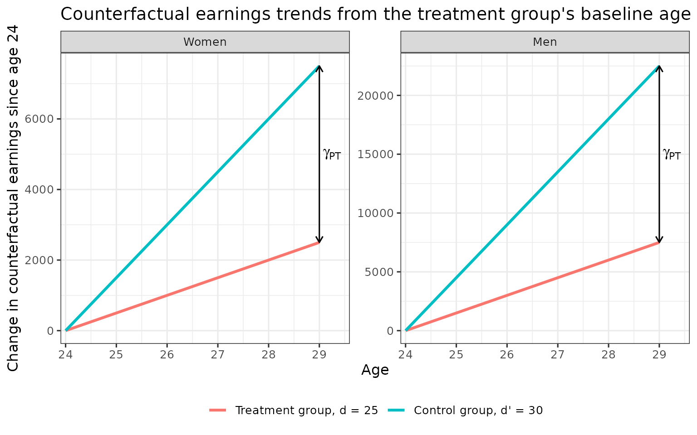
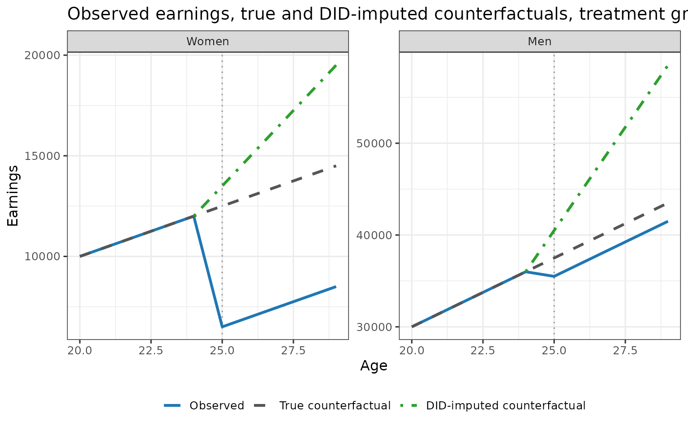
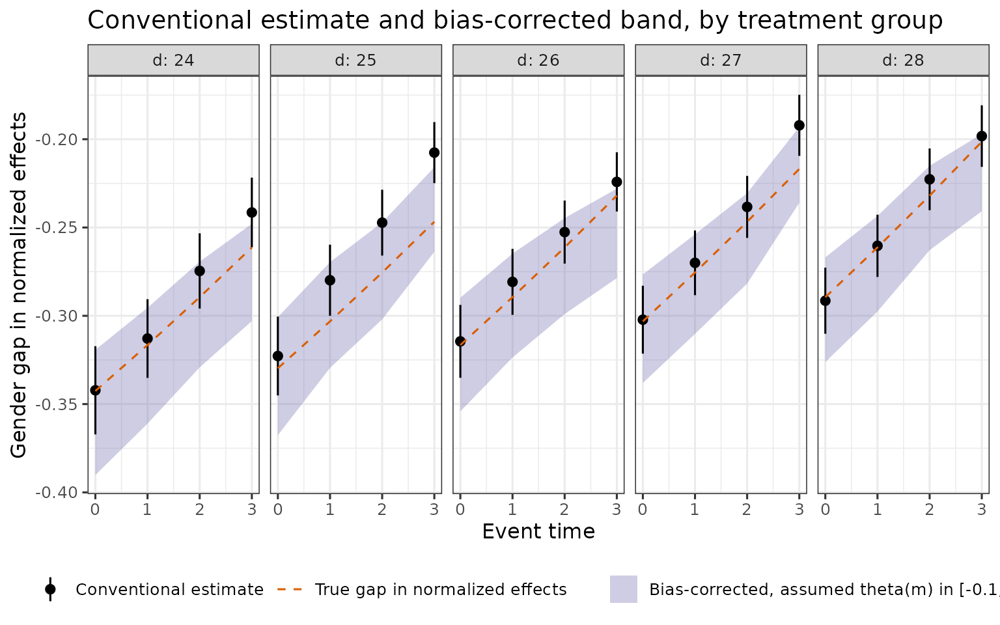

# Identification

This article walks through the identification results of Leventer
(2025), *Identification of Child Penalties* (Sections 2 to 4), in a
stylised world where every population quantity is known, so each result
can be checked by direct computation. Section and theorem numbers refer
to the paper; appendices are referred to by name. Estimators and
standard errors are in
[Estimation](https://dorleventer.github.io/childpen/articles/estimators.md),
aggregation across treatment groups in
[Aggregation](https://dorleventer.github.io/childpen/articles/aggregation.md),
and the paper’s empirical results in [Replicating the
paper](https://dorleventer.github.io/childpen/articles/replication.md).

## Setup

Symbols follow [Notation and
output](https://dorleventer.github.io/childpen/articles/notation.md):
$`g \in \{f,m\}`$ is gender, $`d`$ the treatment group (age at first
birth), $`d'`$ the control group, not yet treated at the target age
$`a`$ ($`d \le a < d'`$). For a single $`(d,d',a)`$ the arguments are
suppressed,
e.g. $`\text{APO}(g,\infty) \equiv \text{APO}(g,d,\infty,a)`$ and
$`\gamma_{\text{PT}}(g) \equiv \gamma_{\text{PT}}(g,d,d',a)`$. Write
$`\mu(g,k,t) = \mathbb{E}[Y_t \mid G=g, D=k]`$ for observed mean
earnings. The descriptive DID estimands are
$`\delta_{\text{APO}}(g) = \mu(g,d,d-1) + [\mu(g,d',a) - \mu(g,d',d-1)]`$,
$`\delta_{\text{ATE}}(g) = \mu(g,d,a) - \delta_{\text{APO}}(g)`$ and
$`\delta_\theta(g) = \delta_{\text{ATE}}(g)/\delta_{\text{APO}}(g)`$.
The example has two genders and treatment groups $`d = 25`$ (early) and
$`d' = 30`$ (late), with counterfactual earnings linear in age, steeper
for the late group and for men, and a constant earnings change from
parenthood in levels. No anticipation and NTD-PT hold by construction;
parallel trends within gender does not.

``` r

toy_world <- function(base   = c(f = 500,   m = 1500),    # slope of the d = 25 group (earnings per year of age)
                      mult   = c(f = 3,     m = 3),       # slope multiple per five years of later first birth
                      ate_lv = c(f = -6000, m = -2000)) { # earnings change from parenthood, in levels
  apo <- function(g, d, a) unname(base[g] * mult[g]^((d - 25) / 5)) * a   # APO(g, d, inf, a)
  mu  <- function(g, d, a) apo(g, d, a) + (a >= d) * unname(ate_lv[g])    # E[Y_a | G = g, D = d]
  ate   <- function(g, d, a) mu(g, d, a) - apo(g, d, a)
  theta <- function(g, d, a) ate(g, d, a) / apo(g, d, a)
  gamma_pt <- function(g, d, dp, a)
    (apo(g, d, a) - apo(g, d, d - 1)) - (apo(g, dp, a) - apo(g, dp, d - 1))
  did_apo   <- function(g, d, dp, a) mu(g, d, d - 1) + mu(g, dp, a) - mu(g, dp, d - 1)
  did_ate   <- function(g, d, dp, a) mu(g, d, a) - did_apo(g, d, dp, a)
  did_theta <- function(g, d, dp, a) did_ate(g, d, dp, a) / did_apo(g, d, dp, a)
  list(apo = apo, mu = mu, ate = ate, theta = theta, gamma_pt = gamma_pt,
       did_apo = did_apo, did_ate = did_ate, did_theta = did_theta)
}
invisible(list2env(toy_world(), environment()))   # apo(), mu(), gamma_pt(), did_apo(), ...
d  <- 25   # treatment group
dp <- 30   # control group
```

In this world

``` math
\text{APO}(g,d,\infty,a) = s_g\,\lambda_g^{(d-25)/5}\,a, \qquad \mu(g,d,a) = \text{APO}(g,d,\infty,a) + \text{ATE}(g)\,1\{a \ge d\},
```

with $`s_f = 500`$, $`s_m = 1500`$, $`\lambda_f = \lambda_m = 3`$,
$`\text{ATE}(f) = -6000`$ and $`\text{ATE}(m) = -2000`$. Since
$`\mu(g,d,a) = \text{APO}(g,d,\infty,a)`$ for $`a < d`$, no anticipation
holds.

## Parallel trends within gender and selection on timing

The difference in counterfactual earnings trends between treatment group
$`d`$ and control group $`d'`$, both measured from the treatment group’s
baseline age $`d-1`$ to age $`a`$, is

``` math
\gamma_{\text{PT}}(g,d,d',a) = \big[\text{APO}(g,d,\infty,a) - \text{APO}(g,d,\infty,d-1)\big] - \big[\text{APO}(g,d',\infty,a) - \text{APO}(g,d',\infty,d-1)\big].
```

DID-PT states $`\gamma_{\text{PT}}(g) = 0`$ for $`d \le a < d'`$.
Section 2 argues that groups that delay childbirth differ in human
capital and so have steeper counterfactual earnings trajectories, which
makes $`\gamma_{\text{PT}}(g) < 0`$ when the control group is a later
group. In the example,
$`\gamma_{\text{PT}}(g,d,d',a) = [s_g(d) - s_g(d')](a - d + 1)`$ with
$`s_g(k)`$ the slope of group $`k`$, negative because the late group is
steeper.

``` r

trend <- expand_grid(g = c("f", "m"), grp = c(25, 30), a = 24:29) |>
  mutate(change = apo(g, grp, a) - apo(g, grp, 24),
         gender = factor(g, c("f", "m"), c("Women", "Men")),
         group  = factor(grp, c(25, 30), c("Treatment group, d = 25", "Control group, d' = 30")))
gap <- expand_grid(g = c("f", "m"), a = 29) |>
  mutate(gender = factor(g, c("f", "m"), c("Women", "Men")),
         lo = apo(g, 30, a) - apo(g, 30, 24),
         hi = apo(g, 25, a) - apo(g, 25, 24))

ggplot(trend, aes(a, change, colour = group)) +
  geom_line(linewidth = 1.1) +
  geom_segment(data = gap, aes(x = a, xend = a, y = lo, yend = hi), inherit.aes = FALSE,
               arrow = arrow(ends = "both", length = unit(0.08, "in"))) +
  geom_text(data = gap, aes(x = a, y = (lo + hi) / 2, label = "gamma[PT]"), parse = TRUE,
            hjust = -0.2, inherit.aes = FALSE) +
  facet_wrap(~ gender, scales = "free_y") +
  scale_x_continuous(breaks = 24:29, expand = expansion(mult = c(0.02, 0.12))) +
  labs(title = "Counterfactual earnings trends from the treatment group's baseline age",
       x = "Age", y = "Change in counterfactual earnings since age 24", colour = NULL)
```



In both panels the control group’s counterfactual trend lies above the
treatment group’s, and the gap $`\gamma_{\text{PT}}(g)`$ widens with the
target age.

DID adds the control group’s change since $`d-1`$ to the treatment
group’s own earnings at $`d-1`$. Under no anticipation (NA:
$`\text{APO}(g,d) = \text{APO}(g,\infty)`$ for $`a < d`$) this
imputation differs from the true counterfactual by exactly
$`\gamma_{\text{PT}}(g)`$ (Lemma 1):

``` math
\delta_{\text{APO}}(g) = \text{APO}(g,\infty) - \gamma_{\text{PT}}(g), \qquad \delta_{\text{ATE}}(g) = \text{ATE}(g) + \gamma_{\text{PT}}(g).
```

``` r

levels_df <- expand_grid(g = c("f", "m"), a = 20:29) |>
  mutate(Observed                     = mu(g, d, a),
         `True counterfactual`        = apo(g, d, a),
         `DID-imputed counterfactual` = if_else(a >= d - 1, did_apo(g, d, dp, a), NA_real_),
         gender = factor(g, c("f", "m"), c("Women", "Men"))) |>
  pivot_longer(c(Observed, `True counterfactual`, `DID-imputed counterfactual`),
               names_to = "series", values_to = "earnings") |>
  mutate(series = factor(series, c("Observed", "True counterfactual", "DID-imputed counterfactual")))

ggplot(levels_df, aes(a, earnings, colour = series, linetype = series)) +
  geom_vline(xintercept = d, colour = "grey60", linetype = "dotted") +
  geom_line(linewidth = 1.1, na.rm = TRUE) +
  facet_wrap(~ gender, scales = "free_y") +
  scale_colour_manual(values = c("Observed" = "#1f77b4", "True counterfactual" = "#555555",
                                 "DID-imputed counterfactual" = "#2ca02c")) +
  scale_linetype_manual(values = c("Observed" = "solid", "True counterfactual" = "dashed",
                                   "DID-imputed counterfactual" = "dotdash")) +
  labs(title = "Observed earnings, true and DID-imputed counterfactuals, treatment group d = 25",
       x = "Age", y = "Earnings", colour = NULL, linetype = NULL)
```



The dotted vertical line marks the age at first birth. With
$`\gamma_{\text{PT}}(g) < 0`$ the DID-imputed counterfactual lies above
the true one by $`|\gamma_{\text{PT}}(g)|`$, so DID ATE lies below the
true ATE by the same amount: DID overstates the earnings loss, and by
more at later ages. The table checks both parts of Lemma 1.

``` r

post <- 25:29
lemma <- expand_grid(g = c("f", "m"), a = post) |>
  mutate(APO = apo(g, d, a), DID_APO = did_apo(g, d, dp, a), gamma = gamma_pt(g, d, dp, a),
         ATE = ate(g, d, a), DID_ATE = did_ate(g, d, dp, a))
stopifnot(all.equal(lemma$DID_APO, lemma$APO - lemma$gamma),
          all.equal(lemma$DID_ATE, lemma$ATE + lemma$gamma))

lemma |>
  transmute(Gender = if_else(g == "f", "Women", "Men"), Age = a, APO, `DID APO` = DID_APO,
            `$\\gamma_{PT}$` = gamma, ATE, `DID ATE` = DID_ATE) |>
  knitr::kable(digits = 0, format.args = list(big.mark = ","))
```

| Gender | Age |    APO | DID APO | $`\gamma_{PT}`$ |    ATE | DID ATE |
|:-------|----:|-------:|--------:|----------------:|-------:|--------:|
| Women  |  25 | 12,500 |  13,500 |          -1,000 | -6,000 |  -7,000 |
| Women  |  26 | 13,000 |  15,000 |          -2,000 | -6,000 |  -8,000 |
| Women  |  27 | 13,500 |  16,500 |          -3,000 | -6,000 |  -9,000 |
| Women  |  28 | 14,000 |  18,000 |          -4,000 | -6,000 | -10,000 |
| Women  |  29 | 14,500 |  19,500 |          -5,000 | -6,000 | -11,000 |
| Men    |  25 | 37,500 |  40,500 |          -3,000 | -2,000 |  -5,000 |
| Men    |  26 | 39,000 |  45,000 |          -6,000 | -2,000 |  -8,000 |
| Men    |  27 | 40,500 |  49,500 |          -9,000 | -2,000 | -11,000 |
| Men    |  28 | 42,000 |  54,000 |         -12,000 | -2,000 | -14,000 |
| Men    |  29 | 43,500 |  58,500 |         -15,000 | -2,000 | -17,000 |

## The validation test and what it validates

Normalized event studies check that the gender gap in normalized DID is
zero before childbirth. For a single $`2\times2`$ with $`d < d'`$ and a
pre-treatment age $`a < d-1`$, the test is
$`\delta_\theta(f) - \delta_\theta(m) = 0`$. Proposition 1 shows what
restriction on potential outcomes this test carries.

**Proposition 1.** Under NA,

``` math
\delta_\theta(f) = \delta_\theta(m) \quad\Longleftrightarrow\quad \frac{\gamma_{\text{PT}}(f)}{\text{APO}(f,\infty)} = \frac{\gamma_{\text{PT}}(m)}{\text{APO}(m,\infty)}.
```

The test is thus a joint test of NA and of equal normalized trend
differences across genders at the pre-treatment age. The same equality
at ages $`d \le a < d'`$ is NTD-PT (equal difference in normalized
trends); by Lemma 1 it says the percentage error of the DID-imputed
counterfactual, $`-\gamma_{\text{PT}}(g)/\text{APO}(g,\infty)`$, is the
same for both genders. TD-PT is the counterpart in levels,
$`\gamma_{\text{PT}}(f) = \gamma_{\text{PT}}(m)`$. As with pre-trends in
DID, the test speaks to the assumption at pre-treatment ages, while the
assumption concerns post-treatment ages.

Each assumption is about one treatment-control pair $`(d,d')`$, and with
the closest not-yet-treated control $`d' = a+1`$ the control group
changes with the target age. The test is therefore run separately for
each control group (Section 2.3). The table takes treatment group
$`d = 25`$ at age $`a = 22`$ against control groups
$`d' = 26, \dots, 31`$. Under NA and with $`\text{ATE} = 0`$ before
treatment, $`\delta_{\text{ATE}}(g) = \gamma_{\text{PT}}(g)`$, so the
DID columns are the pre-trends. The last column repeats the normalized
gap in a world where men’s slope multiple is $`\lambda_m = 4`$ instead
of $`3`$.

``` r

a0   <- 22
dps  <- 26:31
alt  <- toy_world(mult = c(f = 3, m = 4))   # NTD-PT fails: gender-specific slope multiples

pre <- tibble(dp = dps) |>
  mutate(did_f = did_ate("f", d, dp, a0),
         did_m = did_ate("m", d, dp, a0),
         td    = did_f - did_m,
         ntd   = did_theta("f", d, dp, a0) - did_theta("m", d, dp, a0),
         ntd_alt = alt$did_theta("f", d, dp, a0) - alt$did_theta("m", d, dp, a0))

# DID pre-trends equal gamma_PT; the normalized gap is zero iff the normalized gammas agree
stopifnot(all.equal(pre$did_f, gamma_pt("f", d, dps, a0)),
          all.equal(pre$did_m, gamma_pt("m", d, dps, a0)),
          all(abs(pre$ntd) < 1e-10),
          all.equal(gamma_pt("f", d, dps, a0) / apo("f", d, a0),
                    gamma_pt("m", d, dps, a0) / apo("m", d, a0)),
          all(abs(pre$ntd_alt) > 1e-3),
          all(abs(alt$gamma_pt("f", d, dps, a0) / alt$apo("f", d, a0) -
                  alt$gamma_pt("m", d, dps, a0) / alt$apo("m", d, a0)) > 1e-3))

pre |>
  mutate(ntd = round(ntd, 8) + 0) |>
  transmute(`Control group $d'$` = dp,
            `DID, women` = did_f, `DID, men` = did_m,
            `TD gap` = td,
            `Normalized gap` = ntd,
            `Normalized gap, $\\lambda_m = 4$` = ntd_alt) |>
  knitr::kable(digits = c(0, 0, 0, 0, 3, 3), format.args = list(big.mark = ","))
```

| Control group $`d'`$ | DID, women | DID, men | TD gap | Normalized gap | Normalized gap, $`\lambda_m = 4`$ |
|---:|---:|---:|---:|---:|---:|
| 26 | 246 | 737 | -491 | 0 | -0.007 |
| 27 | 552 | 1,656 | -1,104 | 0 | -0.019 |
| 28 | 933 | 2,800 | -1,866 | 0 | -0.041 |
| 29 | 1,408 | 4,225 | -2,816 | 0 | -0.080 |
| 30 | 2,000 | 6,000 | -4,000 | 0 | -0.153 |
| 31 | 2,737 | 8,212 | -5,474 | 0 | -0.305 |

The DID pre-trends are non-zero and grow with the distance between
$`d'`$ and $`d`$, so DID-PT fails; the TD gap is non-zero, so TD-PT
fails. The normalized gap is zero for every control group: in the
example
$`\gamma_{\text{PT}}(g)/\text{APO}(g,\infty) = (1 - \lambda_g^{(d'-d)/5})(a-d+1)/a`$,
which does not depend on gender when $`\lambda_f = \lambda_m`$. With
gender-specific slope multiples the normalized gap is non-zero for every
control group, as Proposition 1 implies.

In the package these tests are the rows with `event_time < 0`,
`method == "Conventional"` and `estimand == "gap_theta"`, one per
control group (`control_offset` $`= d' - d`$), returned when
`periods_pre` is not `NULL`.

## Non-identification of the conventional target

The conventional target is the gender gap in normalized effects,
$`\theta(f) - \theta(m)`$ with
$`\theta(g) = \text{ATE}(g)/\text{APO}(g,\infty)`$; its descriptive
counterpart is the gender gap in normalized DID,
$`\delta_\theta(f) - \delta_\theta(m)`$ (package row: method
`Conventional`, estimand `gap_theta`). Lemma 1 gives the within-gender
normalized DID:

``` math
\delta_\theta(g) = \theta(g)\,\frac{\text{APO}(g,\infty)}{\text{APO}(g,\infty) - \gamma_{\text{PT}}(g)} + \frac{\gamma_{\text{PT}}(g)}{\text{APO}(g,\infty) - \gamma_{\text{PT}}(g)}.
```

The second term is additive and, under NTD-PT, equal across genders, so
it cancels in the gender difference. The first term scales $`\theta(g)`$
by the ratio of true to imputed counterfactual earnings, also equal
across genders under NTD-PT but multiplicative, so it survives
differencing.

**Theorem 1.** Let $`d' > a \ge d`$, assume NA and NTD-PT, and
$`\text{APO}(g,\infty) - \gamma_{\text{PT}}(g) \ne 0`$. Then

``` math
\delta_\theta(f) - \delta_\theta(m) = \text{Bias} \times \big[\theta(f) - \theta(m)\big], \qquad
\text{Bias} = \frac{\text{APO}(g,\infty)}{\text{APO}(g,\infty) - \gamma_{\text{PT}}(g)}, \quad g \in \{f,m\}.
```

With $`\gamma_{\text{PT}}(g) < 0`$, $`\text{Bias} < 1`$ and the
conventional gap is smaller in magnitude than the target gap. Both sides
in the example:

``` r

thm1 <- expand_grid(g = c("f", "m"), a = post) |>
  mutate(APO = apo(g, d, a), gam = gamma_pt(g, d, dp, a),
         bias = APO / (APO - gam), add = gam / (APO - gam),
         th = theta(g, d, a), dth = did_theta(g, d, dp, a))

# Lemma 1, normalized part
stopifnot(all.equal(thm1$dth, thm1$th * thm1$bias + thm1$add))

thm1 <- thm1 |>
  select(g, a, bias, add, th, dth) |>
  pivot_wider(names_from = g, values_from = c(bias, add, th, dth)) |>
  mutate(target = th_f - th_m, conventional = dth_f - dth_m, rhs = bias_f * target)

# Theorem 1: bias term and additive term equal across genders; both sides match
stopifnot(all.equal(thm1$bias_f, thm1$bias_m),
          all.equal(thm1$add_f, thm1$add_m),
          all.equal(thm1$conventional, thm1$rhs))

thm1 |>
  transmute(Age = a, `Bias, women` = bias_f, `Bias, men` = bias_m,
            `$\\theta(f) - \\theta(m)$` = target,
            `$\\delta_\\theta(f) - \\delta_\\theta(m)$` = conventional,
            `Bias $\\times [\\theta(f) - \\theta(m)]$` = rhs) |>
  knitr::kable(digits = 4)
```

| Age | Bias, women | Bias, men | $`\theta(f) - \theta(m)`$ | $`\delta_\theta(f) - \delta_\theta(m)`$ | Bias $`\times [\theta(f) - \theta(m)]`$ |
|---:|---:|---:|---:|---:|---:|
| 25 | 0.9259 | 0.9259 | -0.4267 | -0.3951 | -0.3951 |
| 26 | 0.8667 | 0.8667 | -0.4103 | -0.3556 | -0.3556 |
| 27 | 0.8182 | 0.8182 | -0.3951 | -0.3232 | -0.3232 |
| 28 | 0.7778 | 0.7778 | -0.3810 | -0.2963 | -0.2963 |
| 29 | 0.7436 | 0.7436 | -0.3678 | -0.2735 | -0.2735 |

The additive terms are also equal across genders at every age (checked
in the chunk). The conventional gap is smaller in magnitude than the
target gap at every age, by the factor $`\text{Bias}`$, which falls as
$`\gamma_{\text{PT}}`$ grows relative to $`\text{APO}`$.

## Bias bounding

**Proposition 2.** In the setup of Theorem 1, if
$`\text{APO}(m,\infty)`$ is known,

``` math
\theta(f) - \theta(m) = \big[\delta_\theta(f) - \delta_\theta(m)\big]\,\frac{\delta_{\text{APO}}(m)}{\text{APO}(m,\infty)}.
```

If fathers’ counterfactual earnings are known, $`\gamma_{\text{PT}}(m)`$
is identified through Lemma 1, hence
$`\text{Bias} = \text{APO}(m,\infty)/\delta_{\text{APO}}(m)`$, and
dividing the conventional gap by it gives the target. Observed earnings
identify
$`\text{APO}(m,d) = \mu(m,d,a) = \text{APO}(m,\infty)\,(1 + \theta(m))`$,
so an assumed value of $`\theta(m)`$ is an assumed value of
$`\text{APO}(m,\infty) = \mu(m,d,a)/(1+\theta(m))`$.

The bias-bounding exercise of Section 3.3 evaluates this correction over
a range of assumed $`\theta(m)`$ and compares it with the conventional
estimate. In terms of $`\theta(m)`$ the bias-corrected gap is

``` math
\big[\delta_\theta(f) - \delta_\theta(m)\big]\,\frac{\delta_{\text{APO}}(m)\,(1+\theta(m))}{\mu(m,d,a)}
\;=\; \Delta\rho \cdot \frac{\delta_{\text{APO}}(m)}{\delta_{\text{APO}}(f)}\,(1+\theta(m)),
```

where
$`\Delta\rho = \mu(f,d,a)/\mu(m,d,a) - \delta_{\text{APO}}(f)/\delta_{\text{APO}}(m)`$
is the NTD estimand of the last section. The two expressions are the
same function of the data; the second is the form
[`bias_bounds()`](https://dorleventer.github.io/childpen/reference/bias_bounds.md)
computes. Both are linear in $`\theta(m)`$, so the values at the ends of
an interval bound the whole interval. In the example:

``` r

for (th_m in c(-0.1, 0.1)) {   # assumed theta(m)
  conv  <- did_theta("f", d, dp, post) - did_theta("m", d, dp, post)
  form1 <- conv * did_apo("m", d, dp, post) * (1 + th_m) / mu("m", d, post)
  drho  <- mu("f", d, post) / mu("m", d, post) - did_apo("f", d, dp, post) / did_apo("m", d, dp, post)
  form2 <- drho * did_apo("m", d, dp, post) / did_apo("f", d, dp, post) * (1 + th_m)
  stopifnot(all.equal(form1, form2))
}

# Proposition 2 with the true theta(m) recovers the target gap
conv   <- did_theta("f", d, dp, post) - did_theta("m", d, dp, post)
apo_m  <- mu("m", d, post) / (1 + theta("m", d, post))
stopifnot(all.equal(conv * did_apo("m", d, dp, post) / apo_m,
                    theta("f", d, post) - theta("m", d, post)))
```

### With simulated data

[`simulate_data()`](https://dorleventer.github.io/childpen/reference/simulate_data.md)
attaches the true values, so the band can be compared with the true gap.
The simulation satisfies NTD-PT only approximately (see
[`?simulate_data`](https://dorleventer.github.io/childpen/reference/simulate_data.md)).

``` r

library(childpen)

sim   <- simulate_data(20000, 24:32)
truth <- attr(sim, "truth")
res   <- multiple_treatment_group_analysis(sim, 24:28, periods_post = 3, periods_pre = NULL,
                                           verbose = FALSE)
bb    <- bias_bounds(res, theta_m = c(-0.1, 0, 0.1))

# One cell: the bias-corrected gap at three assumed values of theta(m)
bb |> filter(d == 26, event_time == 3)
#>    d dp  a event_time theta_m        est          se       ci_l       ci_h
#> 1 26 30 29          3    -0.1 -0.2279862 0.007348756 -0.2423897 -0.2135826
#> 2 26 30 29          3     0.0 -0.2533180 0.008165285 -0.2693219 -0.2373140
#> 3 26 30 29          3     0.1 -0.2786498 0.008981813 -0.2962541 -0.2610454
```

[`bias_bounds()`](https://dorleventer.github.io/childpen/reference/bias_bounds.md)
returns one row per post-treatment cell and assumed $`\theta(m)`$. Its
estimate at $`\theta(m) = 0`$ is the midpoint of the estimates at
$`\pm 0.1`$, as linearity implies. The plot shows the conventional
estimate with its 95% confidence interval, the band of bias-corrected
estimates for $`\theta(m) \in [-0.1, 0.1]`$, and the true gap.

``` r

band <- bb |>
  group_by(d, event_time) |>
  summarise(lo = min(est), hi = max(est),
            mid_gap = est[theta_m == 0] - (est[theta_m == -0.1] + est[theta_m == 0.1]) / 2)
stopifnot(max(abs(band$mid_gap)) < 1e-10)

conv_df <- res |>
  filter(method == "Conventional", estimand == "gap_theta", event_time >= 0) |>
  left_join(band, by = c("d", "event_time")) |>
  left_join(select(truth, d, event_time, gap_theta), by = c("d", "event_time"))

ggplot(conv_df, aes(event_time)) +
  geom_ribbon(aes(ymin = lo, ymax = hi, fill = "Bias-corrected, assumed theta(m) in [-0.1, 0.1]"),
              alpha = 0.35) +
  geom_pointrange(aes(y = est, ymin = ci_l, ymax = ci_h, colour = "Conventional estimate"),
                  size = 0.35) +
  geom_line(aes(y = gap_theta, colour = "True gap in normalized effects"), linetype = "dashed") +
  facet_wrap(~ d, nrow = 1, labeller = label_both) +
  scale_x_continuous(breaks = 0:3) +
  scale_colour_manual(values = c("Conventional estimate" = "black",
                                 "True gap in normalized effects" = "#d95f02")) +
  scale_fill_manual(values = c("Bias-corrected, assumed theta(m) in [-0.1, 0.1]" = "#7570b3")) +
  labs(title = "Conventional estimate and bias-corrected band, by treatment group",
       x = "Event time", y = "Gender gap in normalized effects", colour = NULL, fill = NULL) +
  guides(colour = guide_legend(order = 1), fill = guide_legend(order = 2))
```



``` r


c(true_gap_inside_band       = mean(conv_df$gap_theta >= conv_df$lo & conv_df$gap_theta <= conv_df$hi),
  conventional_less_negative = mean(conv_df$est > conv_df$gap_theta))
#>       true_gap_inside_band conventional_less_negative 
#>                       1.00                       0.95
```

The printed shares are the fraction of cells in which the true gap lies
inside the band and the fraction in which the conventional estimate is
less negative than the true gap. The latter matches
$`\gamma_{\text{PT}}(g) < 0`$ and $`\text{Bias} < 1`$ in Theorem 1; the
difference between the conventional estimate and the true gap tends to
widen with event time, as the control group $`d' = a+1`$ moves away from
$`d`$.

## Effect on the gender earnings ratio

Let $`\rho(d) = \text{APO}(f,d)/\text{APO}(m,d)`$ be the realized gender
earnings ratio and
$`\rho(\infty) = \text{APO}(f,\infty)/\text{APO}(m,\infty)`$ the ratio
absent childbirth. The effect of parenthood on the gender earnings ratio
is $`\rho(d) - \rho(\infty)`$.

**Theorem 2.** In the setup of Theorem 1,

``` math
\rho(d) - \rho(\infty) = \frac{\mu(f,d,a)}{\mu(m,d,a)} - \frac{\delta_{\text{APO}}(f)}{\delta_{\text{APO}}(m)}.
```

By consistency, $`\rho(d) = \mu(f,d,a)/\mu(m,d,a)`$. By Lemma 1,
$`\delta_{\text{APO}}(g) = \text{APO}(g,\infty)\,[1 - \gamma_{\text{PT}}(g)/\text{APO}(g,\infty)]`$;
under NTD-PT the bracket is common to both genders and cancels in the
ratio, so
$`\delta_{\text{APO}}(f)/\delta_{\text{APO}}(m) = \rho(\infty)`$.

Since $`\rho(d) = \rho(\infty)\,(1+\theta(f))/(1+\theta(m))`$, the
effect is related to the conventional target by equation (9) of the
paper:

``` math
\rho(d) - \rho(\infty) = \frac{\rho(\infty)}{1+\theta(m)}\,\big[\theta(f) - \theta(m)\big].
```

The two estimands coincide when the factor
$`\rho(\infty)/(1+\theta(m))`$ equals one, and the effect is smaller in
magnitude than the conventional target when it is below one. In the
example:

``` r

thm2 <- tibble(a = post) |>
  mutate(rho_cf  = apo("f", d, a) / apo("m", d, a),     # rho(inf)
         rho_obs = mu("f", d, a) / mu("m", d, a),       # rho(d)
         effect  = rho_obs - rho_cf,
         identified = rho_obs - did_apo("f", d, dp, a) / did_apo("m", d, dp, a),
         target  = theta("f", d, a) - theta("m", d, a),
         factor  = rho_cf / (1 + theta("m", d, a)),
         eq9     = factor * target)

# Theorem 2 and equation (9): both sides match
stopifnot(all.equal(thm2$effect, thm2$identified),
          all.equal(thm2$effect, thm2$eq9))

thm2 |>
  transmute(Age = a, `$\\rho(d)$` = rho_obs, `$\\rho(\\infty)$` = rho_cf,
            `$\\rho(d) - \\rho(\\infty)$` = effect,
            `Theorem 2, right side` = identified,
            `Factor $\\rho(\\infty)/(1+\\theta(m))$` = factor,
            `$\\theta(f) - \\theta(m)$` = target) |>
  knitr::kable(digits = 4)
```

| Age | $`\rho(d)`$ | $`\rho(\infty)`$ | $`\rho(d) - \rho(\infty)`$ | Theorem 2, right side | Factor $`\rho(\infty)/(1+\theta(m))`$ | $`\theta(f) - \theta(m)`$ |
|---:|---:|---:|---:|---:|---:|---:|
| 25 | 0.1831 | 0.3333 | -0.1502 | -0.1502 | 0.3521 | -0.4267 |
| 26 | 0.1892 | 0.3333 | -0.1441 | -0.1441 | 0.3514 | -0.4103 |
| 27 | 0.1948 | 0.3333 | -0.1385 | -0.1385 | 0.3506 | -0.3951 |
| 28 | 0.2000 | 0.3333 | -0.1333 | -0.1333 | 0.3500 | -0.3810 |
| 29 | 0.2048 | 0.3333 | -0.1285 | -0.1285 | 0.3494 | -0.3678 |

In the package this is the row with method `NTD` and estimand
`rho_effect`; its components are the rows `rho_obs`
($`\mu(f,d,a)/\mu(m,d,a)`$) and `rho_cf`
($`\delta_{\text{APO}}(f)/\delta_{\text{APO}}(m)`$). The simulated data
from the previous section give both estimands, with their true values,
at the longest event time:

``` r

# Equation (9) holds exactly in the simulation's true values
stopifnot(with(truth, all.equal(rho_effect, rho_cf / (1 + theta_m) * gap_theta)))

res |>
  filter((method == "Conventional" & estimand == "gap_theta") |
         (method == "NTD" & estimand == "rho_effect"), event_time == 3) |>
  select(d, method, est) |>
  pivot_wider(names_from = method, values_from = est) |>
  left_join(filter(truth, event_time == 3) |> select(d, gap_theta, rho_effect), by = "d") |>
  transmute(`Treatment group $d$` = d,
            `Conventional estimate` = Conventional, `True $\\theta(f) - \\theta(m)$` = gap_theta,
            `NTD estimate` = NTD, `True $\\rho(d) - \\rho(\\infty)$` = rho_effect) |>
  knitr::kable(digits = 3)
```

| Treatment group $`d`$ | Conventional estimate | True $`\theta(f) - \theta(m)`$ | NTD estimate | True $`\rho(d) - \rho(\infty)`$ |
|---:|---:|---:|---:|---:|
| 24 | -0.241 | -0.261 | -0.254 | -0.249 |
| 25 | -0.208 | -0.247 | -0.217 | -0.231 |
| 26 | -0.224 | -0.232 | -0.234 | -0.214 |
| 27 | -0.192 | -0.217 | -0.191 | -0.197 |
| 28 | -0.198 | -0.201 | -0.194 | -0.180 |

The conventional estimate differs from the true gap in normalized
effects through $`\text{Bias}`$ (Theorem 1); the NTD estimate differs
from the true effect through sampling error and the approximation in
NTD-PT. The estimators and their standard errors are written out in
[Estimation](https://dorleventer.github.io/childpen/articles/estimators.md);
the paper’s estimates of both estimands are in [Replicating the
paper](https://dorleventer.github.io/childpen/articles/replication.md).
