# Replicating the paper

This article reproduces the figures of Leventer (2025), *Identification
of Child Penalties*, in the paper’s order, on simulated data: the
Israeli administrative data are confidential. Each section gives the
call, the rows of the output it uses, a short plot, and how the figure
is read. It builds on the earlier articles: [Notation and
output](https://dorleventer.github.io/childpen/articles/notation.md) for
the symbols and rows,
[Identification](https://dorleventer.github.io/childpen/articles/identification.md)
for the assumptions and results,
[Estimation](https://dorleventer.github.io/childpen/articles/estimators.md)
for the estimators and standard errors, and
[Aggregation](https://dorleventer.github.io/childpen/articles/aggregation.md)
for the aggregate estimands.

The simulated data come from
[`simulate_data()`](https://dorleventer.github.io/childpen/reference/simulate_data.md),
designed to show the paper’s patterns: later first births enter the
labor market later and then have steeper earnings growth (so parallel
trends fails in the paper’s direction), effects of parenthood differ by
age at first birth and fade with time since birth, and the gender
earnings ratio falls with age. In this design NTD holds approximately
and TD-E-LOGS exactly; the true values are attached to the data
(`attr(sim, "truth")`) and are overlaid where they help. The numbers are
not the paper’s; the figures are built from the same rows.

## Setup

The grid mirrors the paper’s sample (Section 1.2): treatment groups 24
to 34, event times 0 to 5, pre-treatment event times $`-4`$ to $`-2`$
(baseline age $`d - 1`$), and control groups up to age 40.

``` r

library(childpen)
library(dplyr); library(tidyr); library(ggplot2)
theme_set(theme_bw(base_size = 11))

sim   <- simulate_data(n_individuals = 30000, treatment_groups = 24:40)
truth <- attr(sim, "truth")
res   <- multiple_treatment_group_analysis(sim, treatment_groups = 24:34,
                                           periods_post = 5, periods_pre = 3,
                                           max_control_group = 40, verbose = FALSE)
```

A helper for the pre-treatment (validation) figures, one line per
control group:

``` r

pre_plot <- function(df) {
  ggplot(df, aes(event_time, est, ymin = ci_l, ymax = ci_h,
                 colour = factor(control_offset), fill = factor(control_offset))) +
    geom_hline(yintercept = 0, linetype = 2, colour = "grey50") +
    geom_ribbon(alpha = 0.12, colour = NA) + geom_line() + geom_point(size = 1) +
    scale_x_continuous(breaks = -4:-2) +
    labs(x = "Event time", y = "Estimate", colour = "Control offset", fill = "Control offset")
}
```

## Figure 1: sample statistics (Section 1.2)

**(a) Age at first birth** and **(b) mean earnings by age**, computed
directly from the data.

``` r

sim |> distinct(id, female, D) |> count(female, D) |>
  group_by(female) |> mutate(share = n / sum(n)) |>
  ggplot(aes(D, share, fill = factor(female, 0:1, c("Men", "Women")))) +
  geom_col(position = "dodge") + labs(x = "Age at first birth", y = "Share", fill = NULL)
```

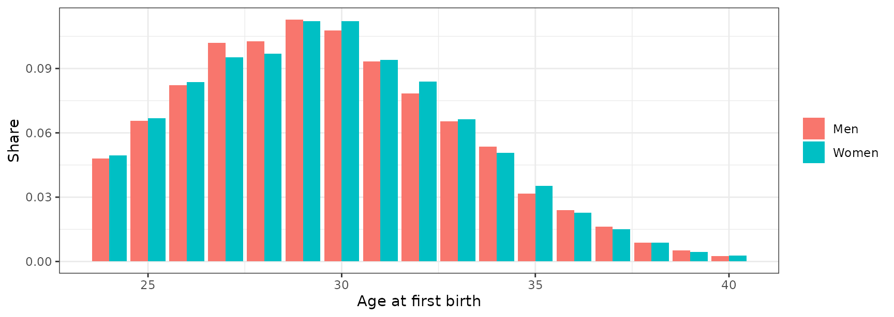

``` r

sim |> filter(D %in% seq(24, 34, 2)) |>
  group_by(D, female, age) |> summarise(Y = mean(Y), .groups = "drop") |>
  ggplot(aes(age, Y, colour = factor(female, 0:1, c("Men", "Women")))) +
  geom_line() + geom_vline(aes(xintercept = D), linetype = 2, colour = "grey50") +
  facet_wrap(~ D, nrow = 1, labeller = label_both) +
  labs(x = "Age", y = "Mean earnings", colour = NULL)
```

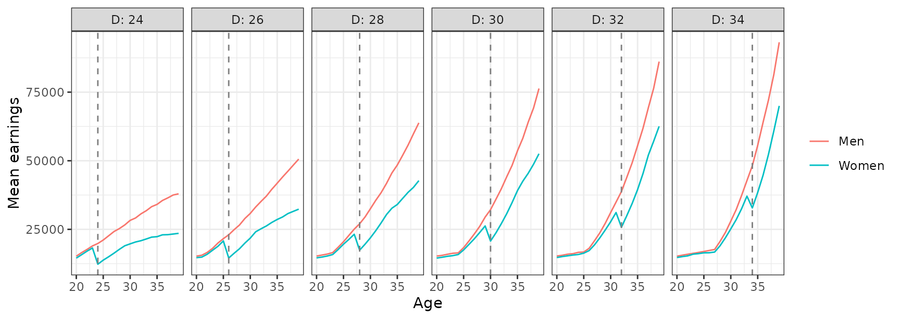

The dashed line marks the age at first birth. Later first births earn
less at young ages and more later on, the life-cycle pattern behind the
selection argument of Section 2.

**(c) The normalized event study** (equations (1)-(2)) is a regression
on event-time indicators with age and calendar-year fixed effects. It is
not computed by the package (any fixed-effects regression package does
it) and needs a calendar year, which the simulated data do not have.

## Figure 2: human capital by age at first birth (Section 2.2)

Figure 2 plots means of pre-birth covariates (grandparents’ earnings,
test scores, high-school credits) by age at first birth and gender. It
needs those covariates, which are part of the confidential data; with
one’s own data it is a table of means by `D` and `female`.

## Figure 3: DID validation tests by treatment-control pair (Section 2.3)

Rows: `DID_Female` and `DID_Male`, estimand `ATE`, pre-treatment event
times.

``` r

res |> filter(event_time < 0, method %in% c("DID_Female", "DID_Male"), estimand == "ATE") |>
  pre_plot() + facet_grid(method ~ d, scales = "free_y")
```

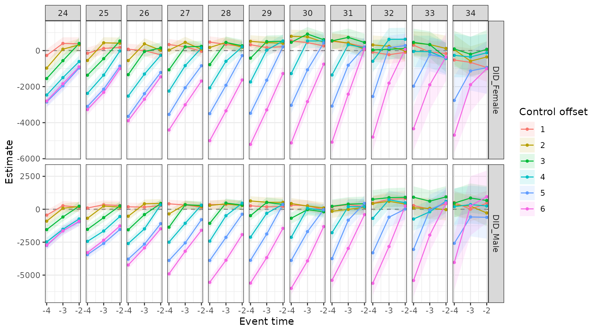

Each line is one treatment-control pair. Under no anticipation, a
pre-treatment DID estimate equals the difference in counterfactual
trends between the two groups at that age, the parallel-trends violation
$`\gamma_{PT}`$ (Lemma 1). Lines away from zero are trend differences
before treatment for that pair; here they grow with the distance to the
control group, as selection on the timing of first birth implies
([Identification](https://dorleventer.github.io/childpen/articles/identification.md)).
Parallel trends is an assumption about post-treatment ages, so these are
suggestive checks, one per pair.

## Figure 4: bias bounding of the conventional estimator (Section 3.3)

Rows: `Conventional` `gap_theta` after treatment, and
[`bias_bounds()`](https://dorleventer.github.io/childpen/reference/bias_bounds.md)
over $`\theta(m) \in [-0.1, 0.1]`$.

``` r

conv <- filter(res, event_time >= 0, method == "Conventional", estimand == "gap_theta")
band <- bias_bounds(res, theta_m = c(-0.1, 0.1)) |>
  group_by(d, event_time) |> summarise(lo = min(est), hi = max(est), .groups = "drop")
ggplot() +
  geom_ribbon(data = band, aes(event_time, ymin = lo, ymax = hi), fill = "orange", alpha = 0.4) +
  geom_ribbon(data = conv, aes(event_time, ymin = ci_l, ymax = ci_h), fill = "grey50", alpha = 0.3) +
  geom_line(data = conv, aes(event_time, est)) +
  geom_point(data = filter(truth, d %in% 24:34, event_time <= 5),
             aes(event_time, gap_theta), shape = 4, colour = "red") +
  facet_wrap(~ d, nrow = 2, labeller = label_both) +
  labs(x = "Event time", y = expression(theta(f) - theta(m)))
```

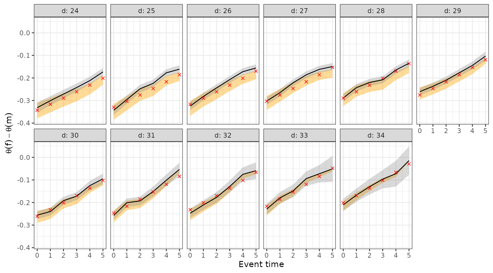

The black line (grey 95% interval) is the conventional estimator. Under
no anticipation and NTD-PT it estimates the gender gap in normalized
effects times a bias factor (Theorem 1). The orange band holds the
bias-corrected gap for fathers’ effects $`\theta(m)`$ between $`-0.1`$
and $`0.1`$ (Proposition 2); the corrected gap is linear in
$`\theta(m)`$, so the band’s two edges span it. The red crosses are the
true gaps. For the earliest groups at later event times, whose control
groups are on steeper trajectories, the conventional estimate lies above
the band, closer to zero than the true gap; for later groups the two are
close.

## Figure 5: NTD validation tests by treatment-control pair (Section 4.2)

Rows: `Conventional` `gap_theta`, pre-treatment event times.

``` r

res |> filter(event_time < 0, method == "Conventional", estimand == "gap_theta") |>
  pre_plot() + facet_wrap(~ d, nrow = 1)
```

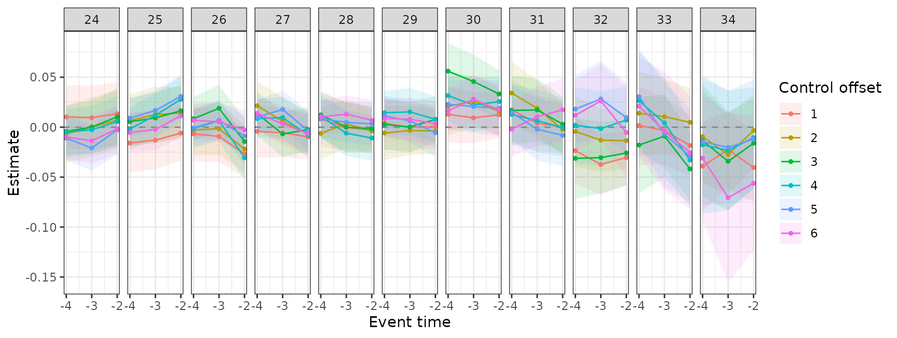

Under no anticipation, a zero pre-treatment gender gap in normalized DID
is equivalent to the NTD restriction at that age, parallel-trends
violations normalized by counterfactual earnings being equal for women
and men (Proposition 1). Each line is the check for one pair. Unlike the
DID tests of Figure 3, these do not grow with the distance to the
control group.

## Figure 6: the effect of parenthood on the gender earnings ratio (Sections 4.1-4.2)

**(a) The two ratios.** Rows: `NTD` `rho_obs` and `rho_cf`.

``` r

res |> filter(event_time >= 0, method == "NTD", estimand %in% c("rho_obs", "rho_cf")) |>
  ggplot(aes(event_time, est, colour = estimand)) +
  geom_hline(yintercept = 1, linetype = 2, colour = "grey50") +
  geom_line() + geom_point(size = 1) + facet_wrap(~ d, nrow = 1) +
  scale_colour_manual(values = c(rho_cf = "#009E73", rho_obs = "#0072B2"),
                      labels = c(rho_cf = "Counterfactual (DID)", rho_obs = "Observed")) +
  labs(x = "Event time", y = "Female/male earnings ratio", colour = NULL)
```

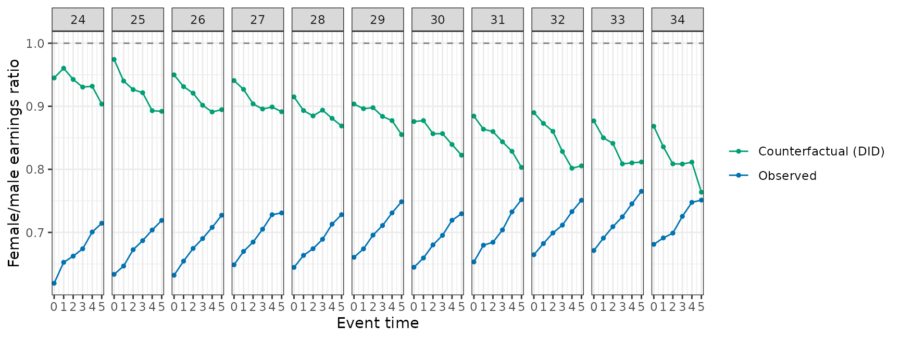

`rho_obs` is the observed female/male earnings ratio, $`\rho(d)`$.
`rho_cf` is the ratio of the DID-imputed counterfactual means; under no
anticipation and NTD-PT it identifies the ratio absent children,
$`\rho(\infty)`$ (Theorem 2).

**(b) The new and the conventional estimator.** Rows: `NTD` `rho_effect`
and `Conventional` `gap_theta`.

``` r

res |> filter(event_time >= 0, (method == "NTD" & estimand == "rho_effect") |
                (method == "Conventional" & estimand == "gap_theta")) |>
  ggplot(aes(event_time, est, ymin = ci_l, ymax = ci_h, colour = method, fill = method)) +
  geom_ribbon(alpha = 0.25, colour = NA) + geom_line() + geom_point(size = 1) +
  facet_wrap(~ d, nrow = 1) +
  scale_colour_manual(values = c(NTD = "#D55E00", Conventional = "#56B4E9")) +
  scale_fill_manual(values = c(NTD = "#D55E00", Conventional = "#56B4E9")) +
  labs(x = "Event time", y = "Estimate (95% CI)", colour = NULL, fill = NULL)
```

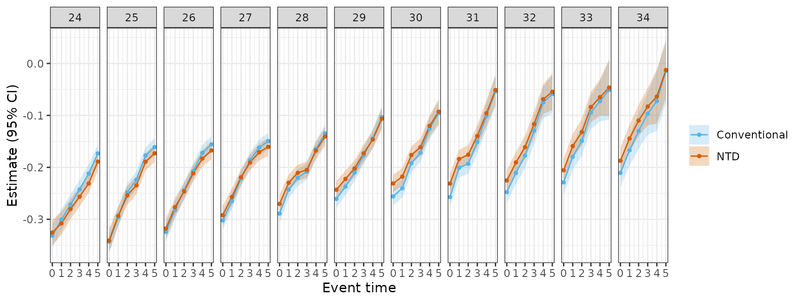

The `NTD` row is the difference of the two ratios in (a): under no
anticipation and NTD-PT it estimates the effect of parenthood on the
gender earnings ratio, $`\rho(d) - \rho(\infty)`$ (Theorem 2). The
`Conventional` row estimates the gender gap in normalized effects times
the bias factor of Theorem 1. The two targets differ:
$`\rho(d) - \rho(\infty)`$ equals $`\theta(f) - \theta(m)`$ scaled by
$`\rho(\infty)/(1 + \theta(m))`$ (equation (9)), so with
$`\rho(\infty) < 1`$ and small fathers’ effects the new estimand is
smaller in absolute value.

**(c) Accounting for the gender gap.** Rows: `NTD` `rho_obs` and
`rho_cf` (the split), or `share_parenthood` (the share, with its
standard error).

``` r

res |> filter(event_time >= 0, method == "NTD", estimand %in% c("rho_obs", "rho_cf")) |>
  select(d, event_time, estimand, est) |>
  pivot_wider(names_from = estimand, values_from = est) |>
  mutate(Parenthood = rho_cf - rho_obs, `Other factors` = 1 - rho_cf) |>
  pivot_longer(c(Parenthood, `Other factors`), names_to = "part") |>
  ggplot(aes(event_time, value, fill = part)) + geom_area() +
  facet_wrap(~ d, nrow = 1) +
  scale_fill_manual(values = c(Parenthood = "#BFDCEC", `Other factors` = "grey80")) +
  labs(x = "Event time", y = "1 - female/male ratio", fill = NULL)
```

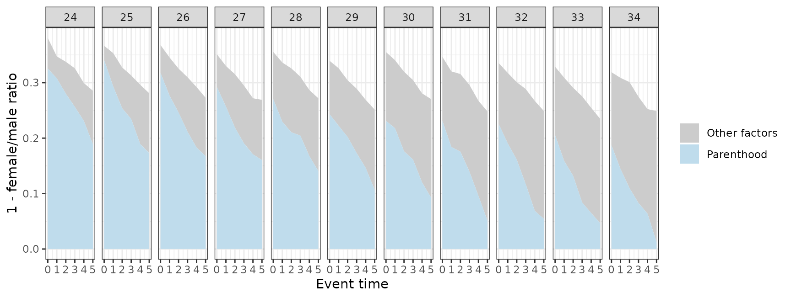

The observed gap $`1 - \rho(d)`$ splits into a part due to parenthood,
$`\rho(\infty) - \rho(d)`$, and a part due to other factors,
$`1 - \rho(\infty)`$; under no anticipation and NTD-PT the first is the
effect of parenthood on the gap. The `share_parenthood` row is the ratio
of the two, with a standard error (the standard error is an addition of
the package, see
[Estimation](https://dorleventer.github.io/childpen/articles/estimators.md)):

``` r

res |> filter(event_time >= 0, method == "NTD", estimand == "share_parenthood") |>
  ggplot(aes(event_time, est, ymin = ci_l, ymax = ci_h)) +
  geom_ribbon(alpha = 0.2) + geom_line() + geom_point(size = 1) +
  geom_point(data = filter(truth, d %in% 24:34, event_time <= 5),
             aes(event_time, share_parenthood), inherit.aes = FALSE, shape = 4, colour = "red") +
  facet_wrap(~ d, nrow = 1) + labs(x = "Event time", y = "Parenthood's share of the gap")
```

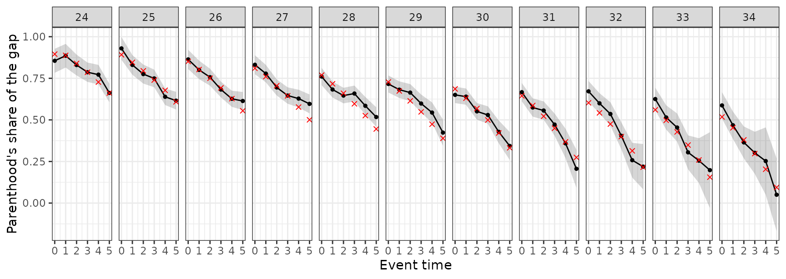

In the simulated data parenthood’s share at childbirth falls with the
age at first birth and, within a group, with time since birth (red
crosses: true values). Groups compared at the same event time are at
different ages; the same shares placed on one age axis separate the two.

## Figure 7: the gender earnings ratio before birth (Section 4.3)

Computed from the data: the female/male ratio of mean earnings at ages
before first birth.

``` r

sim |> filter(age < D, D %in% 27:38, age >= 22) |>
  group_by(D, age) |>
  summarise(rho = mean(Y[female == 1]) / mean(Y[female == 0]), .groups = "drop") |>
  ggplot(aes(age, rho, colour = factor(D))) + geom_line() +
  geom_hline(yintercept = 1, linetype = 2, colour = "grey50") +
  labs(x = "Age", y = "Female/male earnings ratio", colour = "D")
```

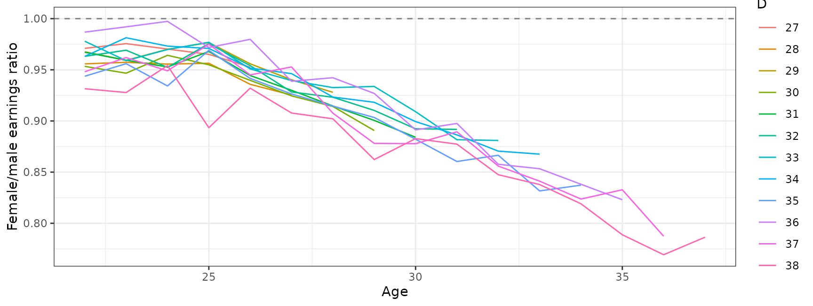

Under no anticipation, earnings before birth are earnings absent
children, so each line is the counterfactual ratio
$`\rho(d, \infty, a)`$ at ages before birth. In the simulated design the
ratio depends on age only, so the lines lie on one curve that falls
after age 25.

## Figure 8: age at first birth across countries (Section 5.2)

Figure 8 uses the OECD Family Database (indicator SF2.3): fertility
rates for first births by five-year age group, normalized to sum to one
within each country. It does not use the package.

## Figure 9: aggregates under different treatment distributions (Section 5.2)

Rows:
[`aggregate_estimands()`](https://dorleventer.github.io/childpen/reference/aggregate_estimands.md)
with three sets of weights, `NTD` `rho_effect`, `weighted_avg`. The
paper’s weights are normal densities with standard deviation 3 and means
26, 29 and 32 over groups 24 to 34.

``` r

dd <- 24:34
dists <- c(`Right-skewed` = 26, Centered = 29, `Left-skewed` = 32)
agg9 <- bind_rows(lapply(names(dists), function(k)
  aggregate_estimands(res, weights = setNames(dnorm(dd, dists[[k]], 3), dd), methods = "NTD") |>
    filter(estimand == "rho_effect") |> mutate(distribution = k)))
ggplot(agg9, aes(event_time, est, ymin = ci_l, ymax = ci_h)) +
  geom_ribbon(alpha = 0.2) + geom_line() + geom_point(size = 1) +
  facet_wrap(~ factor(distribution, names(dists)), nrow = 1) +
  labs(x = "Event time", y = expression(rho[Agg](e)))
```

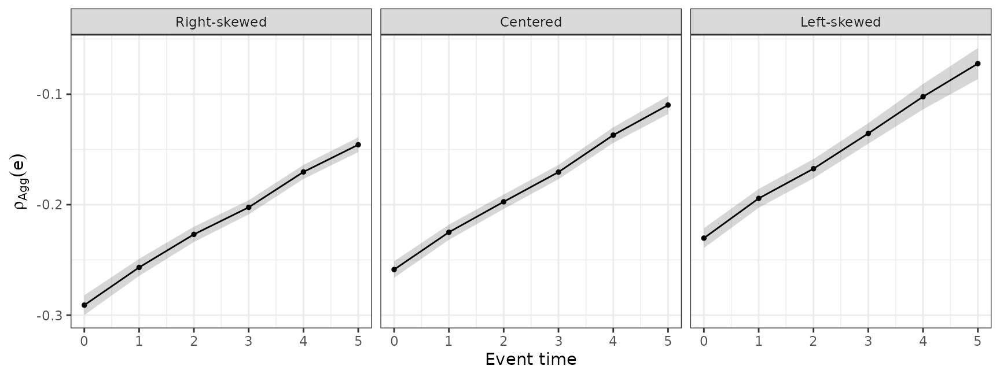

Each panel is the aggregate effect on the gender earnings ratio
(equation (10)) from the same group-level estimates, weighted by a
different distribution of ages at first birth. The panels differ because
the group-level effects differ across groups; comparisons of aggregates
across countries or subgroups mix differences in group-level effects
with differences in these distributions
([Aggregation](https://dorleventer.github.io/childpen/articles/aggregation.md)).

## Online appendix

**Selection on fertility timing in the UK and Germany.** The figure uses
Understanding Society with the harmonised BHPS, and SOEP-CORE (paternal
background and cognitive tests); it does not use the package.

**Proportional DID and TD: validation tests.** Rows: `NTD` and
`TD_E_LOGS` `rho_effect`, `TD_PR` `gap_theta_pre`, pre-treatment event
times, groups 26 to 30.

``` r

res |> filter(event_time < 0, d %in% 26:30,
              (method %in% c("NTD", "TD_E_LOGS") & estimand == "rho_effect") |
                method == "TD_PR") |>
  pre_plot() + facet_grid(method ~ d, scales = "free_y")
```

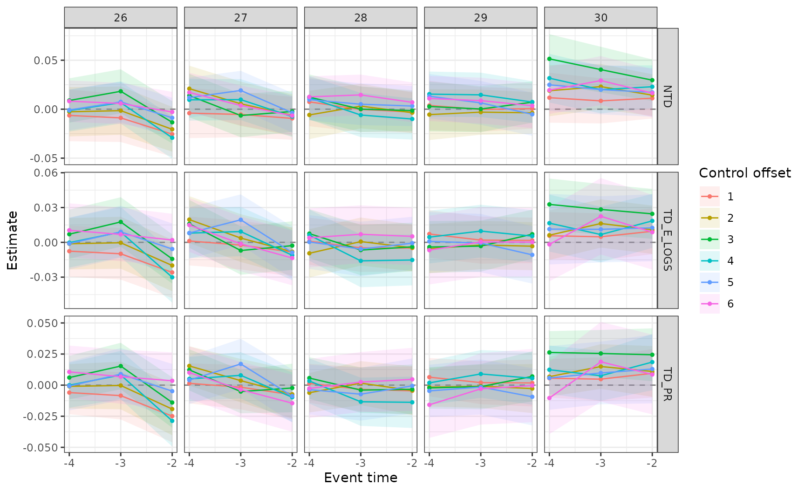

Under no anticipation, each row is zero at a pre-treatment age exactly
when its assumption’s restriction holds there (NTD-PT, TD-E-LOGS,
TD-PR).

**NTD and TD-E-LOGS estimates.** Rows: `NTD` and `TD_E_LOGS`
`rho_effect`, groups 26 to 30.

``` r

res |> filter(event_time >= 0, d %in% 26:30, method %in% c("NTD", "TD_E_LOGS"),
              estimand == "rho_effect") |>
  ggplot(aes(event_time, est, colour = method)) + geom_line() + geom_point(size = 1) +
  geom_point(data = filter(truth, d %in% 26:30, event_time <= 5),
             aes(event_time, rho_effect), inherit.aes = FALSE, shape = 4, colour = "red") +
  facet_wrap(~ d, nrow = 1) + labs(x = "Event time", y = expression(rho(d) - rho(infinity)), colour = NULL)
```

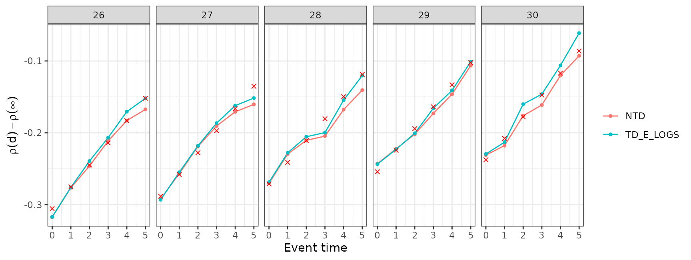

Both rows target $`\rho(d) - \rho(\infty)`$; NTD imputes counterfactual
earnings additively and TD-E-LOGS multiplicatively. Both track the true
values (red crosses) up to sampling noise. In the simulated design
TD-E-LOGS holds exactly and NTD approximately; the systematic difference
is at most about 0.01, smaller than the sampling noise at this sample
size.

**Aggregate estimates.** Rows:
[`aggregate_estimands()`](https://dorleventer.github.io/childpen/reference/aggregate_estimands.md),
`Conventional` `gap_theta` and `NTD` `rho_effect`, `weighted_avg`, with
the default sample weights (the number of mothers and fathers in each
treatment group, as in the paper).

``` r

aggregate_estimands(res, methods = c("Conventional", "NTD")) |>
  filter(estimand %in% c("gap_theta", "rho_effect")) |>
  ggplot(aes(event_time, est, ymin = ci_l, ymax = ci_h, colour = method, fill = method)) +
  geom_ribbon(alpha = 0.2, colour = NA) + geom_line() + geom_point() +
  labs(x = "Event time", y = "Aggregate estimate (95% CI)", colour = NULL, fill = NULL)
```

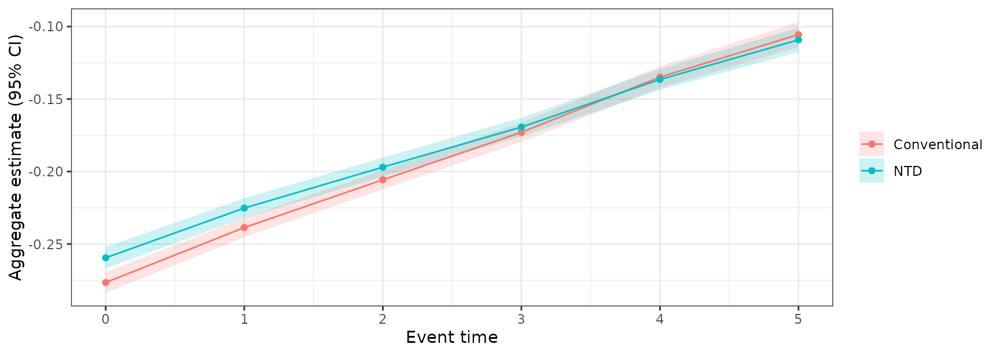

The `NTD` row estimates $`\rho_{Agg}(e)`$ (equation (10)); the
`Conventional` row is the aggregate of the conventional estimator, the
descriptive counterpart of $`\Delta\theta_{Agg}(e)`$ (equation (11)).
The paper’s figure adds the UK and Germany, from survey data.

## Numbers quoted in the paper

Each number in the text comes from one row of the output on the paper’s
data:

| Number in the paper | Row |
|----|----|
| Section 3.3: conventional estimate for $`D = 26`$ five years after birth, and the bias-corrected range | `filter(res, method == "Conventional", d == 26, event_time == 5)`; `filter(bias_bounds(res), d == 26, event_time == 5)` |
| Section 4.2: effect on the gender earnings ratio for $`D = 30`$ five years after birth | `filter(res, method == "NTD", estimand == "rho_effect", d == 30, event_time == 5)` |
| Section 4.2: counterfactual and observed ratio for $`D = 30`$ at birth, and parenthood’s share | `filter(res, method == "NTD", estimand %in% c("rho_cf", "rho_obs", "share_parenthood"), d == 30, event_time == 0)` |
| Section 4.2: parenthood’s share at birth across $`D = 26, \dots, 30`$ | `filter(res, method == "NTD", estimand == "share_parenthood", event_time == 0, d %in% 26:30)` |
| Online appendix: aggregate conventional and new estimates five years after birth | `filter(aggregate_estimands(res), method %in% c("Conventional", "NTD"), estimand %in% c("gap_theta", "rho_effect"), event_time == 5)` |

The paper’s own scripts read the results with earlier labels; the map is
in [Notation and
output](https://dorleventer.github.io/childpen/articles/notation.md).
