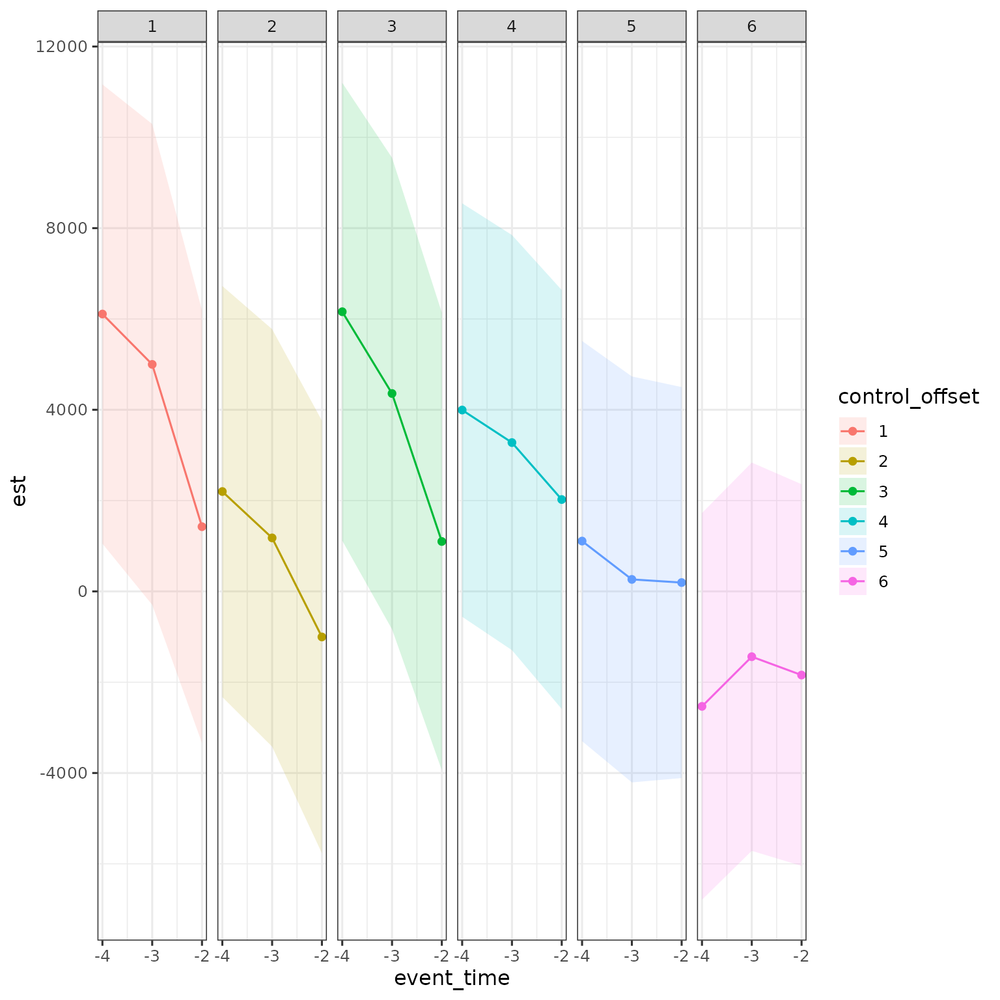
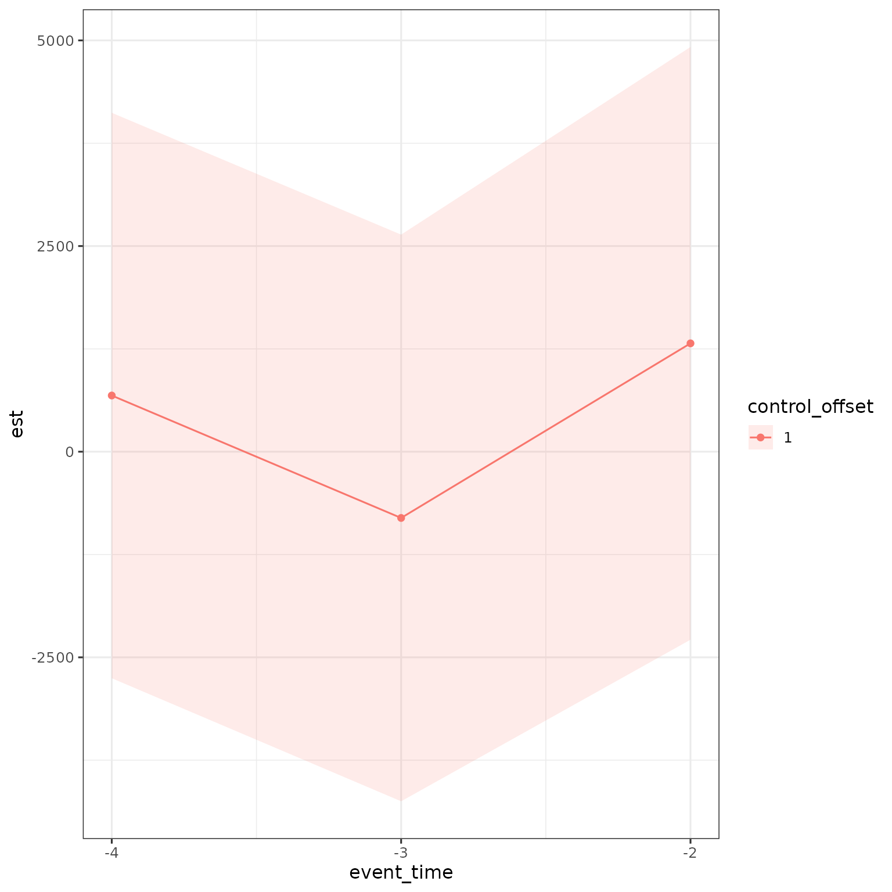
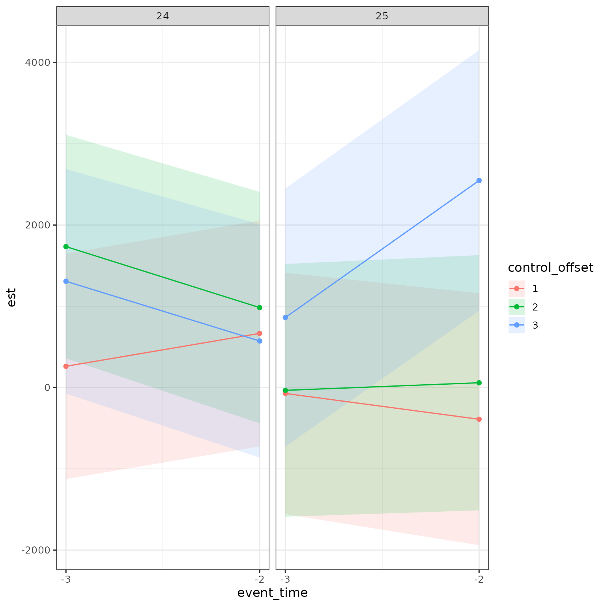
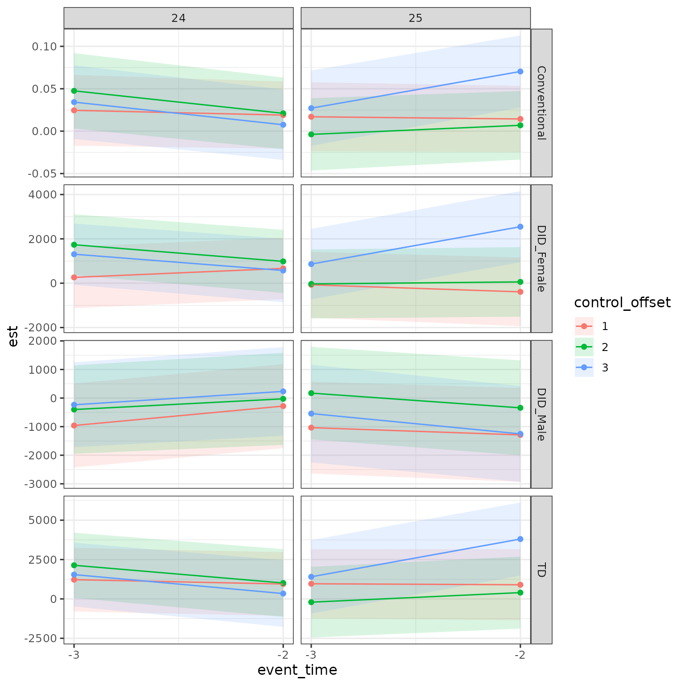

# validation_tests

> **Notation.** For symbol definitions, see the [notation
> vignette](https://dorleventer.github.io/childpen/articles/notation.md).

## Overview

The aim of this vignette is show how to perform correct validation tests
using closest-not-yet-treated control groups using `childpen`.

## Simulate data

The package has a built in simulation function to draw data resembling
child penalty studies.

``` r

library(childpen)

data <- simulate_data(n_individuals = 5000, treatment_groups = 24:28)
data |> tibble()
#> # A tibble: 40,000 × 5
#>       id female   age     D      Y
#>    <int>  <int> <int> <int>  <dbl>
#>  1     1      1    20    24 36267.
#>  2     1      1    21    24 46761.
#>  3     1      1    22    24 40172.
#>  4     1      1    23    24 61655.
#>  5     1      1    24    24 39286.
#>  6     1      1    25    24 52229.
#>  7     1      1    26    24 39057.
#>  8     1      1    27    24 59584.
#>  9     2      1    20    28 50250.
#> 10     2      1    21    28 52739.
#> # ℹ 39,990 more rows
```

## The correct validation tests

See the [estimation
vignette](https://dorleventer.github.io/childpen/articles/estimation.md)
for an explainer on the $`2\times2`$ comparisons in `childpen`. Recall
that $`d`$ is the treatment group, $`a`$ is the target age, and
$`d^\prime=a+1`$ is the closest not-yet-treated control group. Recall
that the control group is $`d' = a + 1`$, the cohort whose first birth
is one year after the target age.

Assume that when presenting results, post-treatment, you report
estimates for event times $`e=0,...,2`$. Then, for each treatment group
$`d`$ you use 3 different control groups in post-treatment estimation.
As the identification assumptions (e.g., parallel trends for DID) must
hold for each point-estimate separately, this implies that it must hold
within each treatment-control pair.

The above argument means that the validation tests should be done
separately by treatment-control combinations. Returning to the above
example, if you want to show results for $`e=0,...,2`$ then you need to
conduct pre-trend analysis for 3 different control groups. This is done
automatically in the `childpen` package, as we show below.

For completeness, the validation tests are:

1.  Difference-in-differences (DID) estimates the average treatment
    effect (ATE) in pre-periods
2.  Triple differences (TD) estimates the gender gap in the ATE in
    pre-periods
3.  Normalized triple differences (NTD) estimates the gender gap in
    normalized effects in pre-periods

## Multiple treatment group analysis

We will now do the main heavy lifting. We run the main estimation
function,
[`multiple_treatment_group_analysis()`](https://dorleventer.github.io/childpen/reference/multiple_treatment_group_analysis.md).
Set `periods_pre` to the number of pre-treatment periods for which you
want to conduct validation tests. As an example, we will examine two
periods pre-treatment. Since we set the number of periods in the
post-treatment to 2 using `periods_post`, this will report validation
tests separately for 3 control groups, as discussed above.

``` r

res = multiple_treatment_group_analysis(data = data,
                                  treatment_groups = 24:25, # which treatment groups to run in the analysis
                                  periods_post = 2, # estimate results for post periods 0:2
                                  periods_pre = 2, # estimate pre-trend diagnostics, set to NULL to omit from estimation
                                  max_control_group = 40, # dont use control groups with first-birth age above 40
                                  min_pre_age = 20, # dont estimate pre-treatment results if target age is below 20
                                  pre = 1, # use 1 period before treatment, can make further away if anticipation is concern
                                  verbose = FALSE # set to TRUE to output progress (i like to time loops) set to FALSE to omit messages
                                  )
```

## Examining results of validation tests

As a first pass, lets see the results.

``` r

res |> tibble()
#> # A tibble: 342 × 17
#>        d    dp     a event_time control_offset estimand  method      est      se
#>    <int> <int> <int>      <int>          <int> <chr>     <chr>     <dbl>   <dbl>
#>  1    24    25    21         -3              1 APO       DID_F…  4.53e+4 7.89e+2
#>  2    24    25    21         -3              1 APO       DID_M…  5.12e+4 8.57e+2
#>  3    24    25    21         -3              1 ATE       DID_F…  2.62e+2 7.07e+2
#>  4    24    25    21         -3              1 ATE       DID_M… -9.60e+2 7.50e+2
#>  5    24    25    21         -3              1 theta     DID_F…  5.78e-3 1.57e-2
#>  6    24    25    21         -3              1 theta     DID_M… -1.88e-2 1.44e-2
#>  7    24    25    21         -3              1 gap_ATE   TD      1.22e+3 1.03e+3
#>  8    24    25    21         -3              1 gap_theta Conve…  2.45e-2 2.13e-2
#>  9    24    25    21         -3              1 rho_effe… NTD     2.21e-2 1.90e-2
#> 10    24    25    21         -3              1 rho_effe… TD_E_…  1.79e-2 1.74e-2
#> # ℹ 332 more rows
#> # ℹ 8 more variables: ci_l <dbl>, ci_h <dbl>, t <dbl>, p <dbl>,
#> #   n_female_treat <int>, n_female_control <int>, n_male_treat <int>,
#> #   n_male_control <int>
```

Focusing on $`d=24`$, lets examine pre-trends. We will start with DID of
females. Generally, valid pre-trend validation tests would behave such
that the confidence intervals include 0, and there is no obvious trend
in the pre-period, and there is no systematic difference between control
groups. A valid pre-trend test shows point estimates near zero with
confidence intervals covering zero and no systematic trend across
pre-treatment event times.

Note that in the plot below `control_offset` (a column of the results)
is the difference between the control group $`d^\prime`$ and the
treatment group $`d`$. E.g., for $`d=24`$ and $`d^\prime=25`$, i.e., the
closest not-yet-treated control group at event time $`e=0`$, I set
control offset to 1.

Ribbons present 95% CI based on standard errors clustered at the
individual level.

``` r

res |>
  filter(d == 24,
         a < d,
         estimand == "ATE",
         method == "DID_Female") |>
  mutate(control_offset = factor(control_offset)) |>
  ggplot(aes(x = event_time, y = est, ymin = ci_l, ymax = ci_h, color = control_offset, fill = control_offset)) +
  geom_ribbon(alpha = .15, color = NA) + geom_point() + geom_line() +
  scale_x_continuous(breaks = -3:-2) +
  facet_grid(cols = vars(control_offset))
```



Although this would be hard to look at, we can put all control offsets
on same plot.

``` r

res |>
  filter(d == 24,
         a < d,
         estimand == "ATE",
         method == "DID_Female") |>
  mutate(control_offset = factor(control_offset)) |> 
  ggplot(aes(x = event_time, y = est, ymin = ci_l, ymax = ci_h, color = control_offset, fill = control_offset)) +
  geom_ribbon(alpha = .15, color = NA) + geom_point() + geom_line() + 
  scale_x_continuous(breaks = -3:-2)
```



Can do this for multiple treatment groups at same time

``` r

res |> 
  filter(a < d, 
         estimand == "ATE",
         method == "DID_Female") |> 
  mutate(control_offset = factor(control_offset)) |> 
  ggplot(aes(x = event_time, y = est, ymin = ci_l, ymax = ci_h, color = control_offset, fill = control_offset)) +
  geom_ribbon(alpha = .15, color = NA) + geom_point() + geom_line() + 
  scale_x_continuous(breaks = -3:-2) + 
  facet_grid(cols = vars(d))
```



Finally, can do this for all methods.

``` r

res |> 
  filter(a < d, 
         estimand == "ATE" & (method == "DID_Female" | method == "DID_Male") |
           estimand == "gap_ATE" & method == "TD" |
           estimand == "gap_theta" & method == "Conventional") |>
  mutate(control_offset = factor(control_offset)) |> 
  ggplot(aes(x = event_time, y = est, ymin = ci_l, ymax = ci_h, color = control_offset, fill = control_offset)) +
  geom_ribbon(alpha = .15, color = NA) + geom_point() + geom_line() + 
  scale_x_continuous(breaks = -3:-2) + 
  facet_grid(cols = vars(d), rows = vars(method), scales = "free")
```


